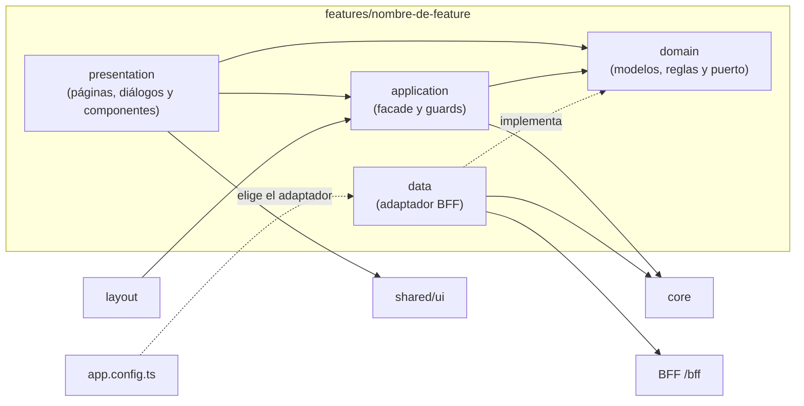

# Arquitectura del frontend

Cómo se organiza el código del workspace Angular: dos aplicaciones (Storefront y Admin), reglas de dependencia, convenciones, integración con el BFF y pruebas. Sigue el mismo esquema que el frontend de IdShield.

No incluye versiones (están en [`package.json`](package.json)) ni comandos (están en el [README](../README.md) y en el [`AGENTS.md` raíz](../AGENTS.md)). La vista de sistema está en [`docs/architecture/README.md`](../docs/architecture/README.md).

## 1. Alcance y stack

| Pieza | Uso |
|---|---|
| Angular | Componentes standalone, signals, `inject()`, `OnPush`, formularios reactivos tipados y rutas con carga diferida |
| Angular Material y CDK | Diálogos, menús, selects, foco y overlays |
| Tailwind CSS (vía PostCSS) | Layout y utilidades; solo analiza el código de cada aplicación (`source(none)` + `@source '.'` en `styles.css`) |
| Tokens CSS | Paleta B (azul cobalto, el tema por defecto y el respaldo), tipografía y espaciado en [`src/styles/tokens.css`](src/styles/tokens.css). El tema activo llega del BFF (`/bff/appearance/theme.css`) y redefine los tokens del tema; ver [§5](#5-integración-con-el-bff) y el [sistema visual](docs/VISUAL-SYSTEM.md) |
| ESLint, angular-eslint y Sheriff | Calidad y límites entre capas y features ([`eslint.config.mjs`](eslint.config.mjs), [`sheriff.config.ts`](sheriff.config.ts)) |

## 2. Estilo arquitectónico

Cada aplicación se organiza **por features con capas internas** ([ADR-0006](../docs/adrs/0006-organizar-el-frontend-por-features-y-capas.md)). Dentro de cada feature se aplican puertos y adaptadores: `domain/` define el puerto `<Concepto>Gateway` (clase abstracta, sin Angular) y `data/` lo implementa con `Bff<Concepto>Gateway`. `app.config.ts` es la raíz de composición: asocia cada puerto con su adaptador.



### 2.1. Reglas obligatorias

| Desde | Puede depender de | No puede depender de |
|---|---|---|
| `domain/` | `domain/` de su feature o de otra feature permitida | Angular, RxJS ni ninguna otra capa |
| `application/` | `application/` y `domain/` de su feature o de otra permitida, `core/` | `data/`, `presentation/`, `@angular/common/http` |
| `data/` | `domain/`, `core/`, `HttpClient` | `application/`, `presentation/` |
| `presentation/` | `application/`, `domain/`, `core/`, `shared/ui/` | `data/`, `@angular/common/http` |
| `<feature>.routes.ts` | `presentation/` y `application/` de su feature | `data/` |
| `layout/` | `application/` y `domain/` de las features, `core/`, `shared/ui/` | `data/` |
| `shared/ui/` | `core/` | `features/`, `layout/` |
| `core/` | Solo Angular y librerías técnicas | `features/`, `layout/`, `shared/` |
| Raíz de composición (`app.config.ts`, `app.routes.ts`) | Todo | — |

1. Una feature solo usa `domain/` y `application/` de otra, en la dirección declarada en `sheriff.config.ts` y sin ciclos. Storefront y Admin no se importan entre sí.
2. Solo `data/` y `core/` usan `HttpClient`. La aplicación recibe los errores del BFF como `BffRequestError` ([`core/bff-request.error.ts`](src/app/core/bff-request.error.ts)).
3. Cada feature tiene una sola facade, que expone el estado con signals y coordina las operaciones. Las páginas no llaman al BFF.
4. No se crean capas vacías, abstracciones que solo deleguen ni barrels (`index.ts`).

Sheriff impone la regla 1; `no-restricted-imports` impone la parte de las reglas 1 y 2 que afecta a librerías externas. Las dos corren con `npm run lint` y la prueba [`tests/architecture/boundaries.test.mjs`](tests/architecture/boundaries.test.mjs) comprueba que siguen rechazando lo prohibido. Si una regla bloquea un cambio, se corrige el diseño, no la regla.

**Diferencia con IdShield.** En IdShield una facade no usa la de otra feature. En WebStore sí, en la dirección declarada, porque el negocio lo pide: el checkout coordina carrito, cuenta y pedidos, y el carrito concilia precios con el catálogo. El grafo sigue siendo acíclico.

### 2.2. Dependencias entre features

```text
Storefront                                   Admin
vitrina  → catalogo, carrito, contenido      tienda → sesion
carrito  → catalogo                          temas  → sesion
checkout → carrito, catalogo, cuenta, envios, pedidos
pedidos  → carrito, catalogo, cuenta, envios
envios   → contenido
```

## 3. Organización del código

```text
src/app/                                  projects/admin/src/app/
├── app.config.ts, app.routes.ts, app.ts  ├── app.config.ts, app.routes.ts, app.ts
├── core/        (BFF: URL base, cabeceras ├── core/        (cabecera Bearer)
│                 y errores)               ├── layout/      (AppLayout, MenuUsuarioComponent)
├── layout/      (AppLayout, menú de       └── features/
│                 categorías, 404)             ├── sesion/  (login, perfil, roles y permisos, guards)
├── shared/ui/   (empty-state, reveal)         ├── tienda/  (resumen, productos, inventario,
└── features/                                  │             categorías, marcas, clientes, usuarios,
    ├── catalogo/  productos y categorías      │             pedidos, banners, contenido, tarifas,
    ├── vitrina/   inicio, /inicio-anterior,   │             reclamaciones)
    │              listado, ficha y tarjeta    └── temas/   (apariencia, tema visible y gestión
    ├── carrito/   ├── checkout/  ├── pedidos/                de los temas del superadmin)
    ├── cuenta/    ├── envios/    ├── contenido/ (CMS y páginas informativas)
    ├── reclamos/  (libro de reclamaciones)
    └── temas/     (apariencia y tema visible)
```

`temas` existe en las dos aplicaciones, sin código compartido: cada una tiene su modelo, su puerto, su regla `temaVisible` y su `TemasFacade`, que carga la apariencia del BFF y aplica los tokens del tema visible a `<html>`. La de la tienda no depende de ninguna feature y solo la usa la raíz (`App`). La del Admin depende de `sesion` para el token y, además, gestiona los temas del `superadmin`: ante `STALE_THEMES` avisa y recarga la lista, sin reintentar.

`vitrina` agrupa la presentación que combina catálogo, carrito y contenido (inicio, listado, ficha de producto, tarjeta y diálogo de agregar al carrito). Así `catalogo` no depende de `carrito`, que sí depende de `catalogo`.

Cada feature tiene hasta cuatro capas, cada una en una carpeta plana. Las rutas de la feature van en `<feature>.routes.ts`, en su raíz (`cuenta`, `vitrina`). `app.routes.ts` conserva las URL públicas: `/`, `/inicio-anterior`, `/catalogo`, `/carrito`, `/checkout`, `/pedido/:id`, `/pedidos`, `/cuenta/*`, `/info/*`, `/libro-reclamaciones` y la página 404.

## 4. Componentes y convenciones

- Componentes standalone con `inject()`, signals, `input`/`output`, control de flujo integrado y `OnPush`.
- Selectores con prefijo `ws-` (los estilos dependen de ellos) y directivas `ws…`.
- Colores y estados como tokens en `src/styles/tokens.css`. El Admin reutiliza esos tokens.
- Formato: Prettier ([`.prettierrc.json`](../.prettierrc.json) en la raíz del repositorio).

El nombre del archivo indica su rol con un sufijo. La parte de negocio va en español y el término técnico en inglés:

| Rol | Capa | Archivo | Identificador |
|---|---|---|---|
| Modelo | `domain/` | `producto.model.ts` | `Producto`, `Categoria` |
| Reglas | `domain/` | `categoria.rules.ts`, `rol.rules.ts` | `descendientesDeCategoria()`, `rolPuede()` |
| Puerto | `domain/` | `catalogo.gateway.ts` | `CatalogoGateway`, clase abstracta |
| Facade | `application/` | `carrito.facade.ts` | `CarritoFacade` |
| Guard | `application/` | `pagina-informativa.guard.ts`, `permiso.guard.ts` | `contactoHabilitadoGuard`, `permisoGuard` |
| Adaptador del BFF | `data/` | `bff-catalogo.gateway.ts` | `BffCatalogoGateway` |
| Página | `presentation/` | `detalle-producto.page.ts` | `DetalleProductoPage` |
| Diálogo | `presentation/` | `agregar-al-carrito.dialog.ts` | `AgregarAlCarritoDialog` |
| Componente | `presentation/`, `layout/`, `shared/ui/` | `tarjeta-producto.component.ts` | `TarjetaProductoComponent` |
| Layout | `layout/` | `app.layout.ts` | `AppLayout` |
| Rutas | raíz de la feature | `cuenta.routes.ts` | `cuentaRoutes` |
| Prueba unitaria | junto al código | `categoria.rules.spec.mjs` | — |

- Las piezas sin vocabulario de negocio van en inglés técnico: `EmptyStateComponent`, `RevealDirective`, `BffRequestError`, `bearer()`.
- **Filtros de un listado del Admin** (feature [008](../docs/specs/features/008-filtros-y-registro-del-catalogo/planning.md), entregada con el [PR #48](https://github.com/sebastianaviladev01-xyz/WebStore/pull/48)): los filtros aplicados y la página viven en los parámetros de la URL, no en una signal de la página ni en el navegador. Productos usa `nombre`, `sku`, `categoria`, `marca`, `estado` y `pagina`; Categorías, `nombre`, `padre` y `pagina`; Marcas, `nombre`, `estado` y `pagina`. La página los lee con `leerFiltros*()` y `leerPagina()` y los escribe con `parametrosDeFiltros*()` (`filtro-catalogo.rules.ts`), sin los valores por defecto; un valor desconocido se lee como el valor por defecto. El panel edita un borrador que se iguala a los parámetros cada vez que cambian (también con atrás y adelante); «Buscar» recarga el snapshot con `TiendaFacade.refresh()` y navega sin `pagina`. Las interfaces de registro son rutas propias (`<listado>/nuevo` antes que `<listado>/:id`, con el `id` como `input`) y conservan los parámetros al ir y al volver (`queryParamsHandling: 'preserve'`). Las piezas compartidas son `PanelFiltrosComponent` (`ws-filter-panel`), `PaginacionComponent` (`ws-pagination`) y `paginar()` de `listado.rules.ts` (`ELEMENTOS_POR_PAGINA`, 25).
- **Pendiente de migrar** (como hizo IdShield en su reorganización): siguen en inglés los métodos, propiedades y signals de las clases (`add()`, `products()`, `isEmpty`), las constantes y funciones auxiliares internas y los campos y rutas del contrato HTTP (`/bff/catalog/products`, `price`, `stock`). No se toman como ejemplo para código nuevo.

## 5. Integración con el BFF

- Los adaptadores `Bff<Concepto>Gateway` usan `HttpClient` contra `/bff`, que el servidor de desarrollo reenvía al BFF con [`proxy.conf.json`](proxy.conf.json).
- Sesiones: el cliente guarda un token opaco en `sessionStorage` y lo envía como `Bearer`. Los guards son UX; la autorización la repite el BFF.
- El carrito guarda solo id y cantidad en `localStorage`; precio y stock se toman siempre del catálogo vigente. Al leerlo, une las líneas del mismo producto, y cada recarga del catálogo lo concilia con `conciliarCarrito` (`carrito/domain/carrito.rules.ts`), que devuelve lo que cambió para avisarlo (lote 04).
- Checkout (lote 04, [ADR-0017](../docs/adrs/0017-cerrar-el-backlog-por-lotes-como-excepcion-al-flujo.md)): `CheckoutFacade.iniciar()` recarga el catálogo, borra el error anterior y abre un intento de compra con una clave aleatoria que `BffCheckoutGateway` envía en `Idempotency-Key`; un segundo envío en curso se ignora. El comando lleva `termsAccepted` y el `total` que ve el comprador; ante `INSUFFICIENT_STOCK`, `PRODUCT_UNAVAILABLE`, `ORDER_TOTAL_CHANGED` o `SHIPPING_UNAVAILABLE` la facade recarga el catálogo y la página vuelve a cotizar el envío y avisa lo que cambió. `CatalogoFacade.load()` comparte la carga en curso.
- Pedidos: `PedidosFacade` guarda en `localStorage` solo el token de los pedidos de invitado y vacía los pedidos en memoria cuando cambia la sesión de cliente; la regla de si un pedido se puede cambiar es `sePuedeModificar` (`pedidos/domain/pedido.rules.ts`), la misma del BFF (lote 04).
- Contrato: [`backend/docs/BFF-CONTRACT.md`](../backend/docs/BFF-CONTRACT.md).

Temas (feature [002](../docs/specs/features/002-temas-configurables/planning.md)):

- Tema activo ([ADR-0010](../docs/adrs/0010-aplicar-el-tema-activo-con-una-hoja-de-estilos-del-bff.md)): los dos `index.html` cargan `/bff/appearance/theme.css` con un `<link rel="stylesheet">` que bloquea el primer pintado. La hoja redefine los tokens del tema en un bloque `:root:root`, que gana a `tokens.css`. `tokens.css` es la paleta B y el respaldo, y las plantillas y los estilos solo usan tokens (lo comprueba `tools/validate-structure.mjs`, TEST-18). Durante la sesión, `TemasFacade` aplica los cambios con `style.setProperty` sobre `<html>`.
- Build: el `<link>` lleva `data-beasties-skip`. La optimización de CSS crítico de `@angular/build` (beasties) intenta leer del disco las hojas de `index.html` y avisa «Unable to locate stylesheet /bff/appearance/theme.css». Con el atributo, la deja fuera: el build no avisa y la hoja sigue bloqueando el pintado (sin `media="print"`). Lo comprueba TEST-18 (c).
- **Riesgo aceptado:** si el BFF acepta la conexión y no responde, la página espera la hoja hasta el tiempo límite del navegador. Si la rechaza o responde con error, se ve B (TEST-22).
- Cálculo ([ADR-0011](../docs/adrs/0011-guardar-los-temas-como-recurso-propio-del-bff.md)): el BFF calcula los tokens y el contraste. El dominio de la feature `temas` del Admin los replica solo para la vista previa, y la tienda no calcula nada.
- Lienzo de la tienda ([ADR-0013](../docs/adrs/0013-dar-a-la-tienda-un-token-propio-para-su-lienzo.md)), de la feature [004](../docs/specs/features/004-ajustes-de-la-tienda/planning.md), entregado con el [PR #26](https://github.com/sebastianaviladev01-xyz/WebStore/pull/26): la tienda pinta su lienzo con el token `--ws-store-bg` (en `html`, `body`, el shell y la página 404) y la clase `bg-store-canvas` (`--color-store-canvas` en `tokens.css`), y la vista previa de Temas del Admin también. `bg-canvas` sigue siendo `--ws-bg`: el lienzo del Admin y el relleno de los buscadores. La réplica del Admin incluye el token y los pares nuevos (31 tokens y 20 pares).
- Texto sobre el enlace ([ADR-0014](../docs/adrs/0014-dar-al-tema-un-token-para-el-texto-sobre-el-enlace.md), aceptado), de la feature [005](../docs/specs/features/005-contraste-de-controles-con-los-temas/planning.md), entregado con el [PR #35](https://github.com/sebastianaviladev01-xyz/WebStore/pull/35): `tokens.css` declara `--ws-on-link: #ffffff` (el valor de B) y mapea `--mat-sys-on-primary` a `var(--ws-on-link)`, porque `--mat-sys-primary` ya es el enlace. Con C, la marca de las casillas marcadas del Admin pasa de 1:1 a 15.80:1. El botón relleno conserva sus tokens de la feature 004 (`--ws-primary` y `--ws-on-primary`) y suma `--mat-button-filled-state-layer-color: var(--ws-on-primary)`. La réplica del Admin incluye el token y el par `onLink/link` (32 tokens y 21 pares), y `NombreToken` lo tiene en las dos aplicaciones. Sin clase de Tailwind: ninguna plantilla lo usa.
- Enlaces de la tienda (feature [005](../docs/specs/features/005-contraste-de-controles-con-los-temas/planning.md), D1), entregado con el [PR #35](https://github.com/sebastianaviladev01-xyz/WebStore/pull/35): la regla `a { color: inherit; text-decoration: none; }` de `src/styles.css` está dentro de `@layer base`, junto a la de márgenes. Fuera de capa anulaba las utilidades de color y de subrayado de los enlaces, que ahora se aplican. Las clases `ws-*` y `a:focus-visible` siguen fuera de capa y no cambian.
- Vista previa en modo demo ([ADR-0012](../docs/adrs/0012-activar-el-modo-demo-y-recordar-la-vista-previa-en-una-cookie.md)): `TemasFacade.verTema` guarda el id del tema en la cookie `ws_tema_vista_previa` (`Path=/`, `SameSite=Lax`, 30 días, `Secure` con `https`), que comparten la tienda y el Admin y que el BFF lee solo en modo demo para servir `theme.css`. La tuerca «Cambiar tema» (`SelectorTemaComponent`, en las dos aplicaciones) solo existe en modo demo y es la que usa la cookie.

## 6. Pruebas

| Nivel | Herramienta | Qué se prueba |
|---|---|---|
| Unitarias de `domain/` | `node:test`, archivos `*.spec.mjs` junto al código (`npm test`) | Árbol de categorías del storefront, tarifas de envío del Admin e indicadores del Resumen del Admin (`resumen.rules.spec.mjs`: variación, clientes nuevos, serie del mes, distritos, últimos pedidos y estados), roles y permisos del Admin (`rol.rules.spec.mjs`), las iniciales del usuario del Admin (`usuario-admin.rules.spec.mjs`: `inicialesDeUsuario`) y, de la feature `temas`, el tema visible de la tienda y del Admin (`tema-visible.rules.spec.mjs`) y la réplica de las reglas de temas del Admin (`tema.rules.spec.mjs`, que lee los mismos casos que el BFF). La facade de `temas` del Admin también tiene prueba unitaria (`temas.facade.spec.mjs`: sin reintento tras `STALE_THEMES`). De la feature de filtros y registro del catálogo (008), en `tienda` del Admin: la caracterización del árbol de categorías (`categoria.rules.spec.mjs`), las reglas genéricas de listado (`listado.rules.spec.mjs`: texto sin mayúsculas ni tildes y páginas de 25) y los filtros y sus parámetros de la URL (`filtro-catalogo.rules.spec.mjs`), con la facade (`tienda.facade.spec.mjs`: `load()` y `refresh()`). Del lote 04, en la tienda: el carrito (`carrito.rules.spec.mjs`: líneas guardadas, unidades agregadas y conciliación), la fecha de entrega con la fecha de Lima (`fecha-entrega.rules.spec.mjs`) y si un pedido se puede cambiar (`pedido.rules.spec.mjs`) |
| Límites de arquitectura | `node:test` con la API de ESLint ([`tests/architecture/`](tests/architecture/), `npm run test:architecture`) | Que Sheriff y `no-restricted-imports` rechazan lo prohibido y aceptan lo permitido, sin escribir en `src/` |
| Estructura y contrato | [`tools/validate-structure.mjs`](../tools/validate-structure.mjs) y el smoke test del BFF (`npm run validate:contract` desde la raíz) | Rutas, guards, CMS compartido, roles, el contrato HTTP completo (incluidos los temas), que el tema B del BFF sea igual a `tokens.css`, que no quede ningún color fijo fuera de `tokens.css` y que no falte el `<link>` de `theme.css` |
| E2E | Playwright ([`tests/e2e/`](tests/e2e/), [`playwright.config.ts`](playwright.config.ts)), `npm run test:e2e` | Recorridos derivados de la [matriz de trazabilidad](../docs/planning/TRACEABILITY.md) contra el BFF de prueba real: navegación y 404, catálogo y ficha, carrito con IGV, compra como invitado, cuenta de cliente, libro de reclamaciones, CMS y acceso al Admin por rol. De la feature de temas: `storefront-temas` (con C activo, la tienda no conserva colores de B, y la hoja no parpadea), `storefront-modo-demo` y `admin-modo-demo` (la tuerca «Cambiar tema» y su vista previa) y `admin-temas` (la página de temas del `superadmin`). De la feature de ajustes del Admin: `admin-menu-lateral` (grupos plegables del menú lateral), `admin-resumen` (bloques plegables del Resumen) y `admin-menu-usuario` (menú de usuario de la cabecera y página Perfil). De la feature de ajustes de la tienda: `storefront-checkout-panel` (el panel de los tres pasos del checkout y sus campos con contorno: reposo, foco, error, orden de Tab y movimiento reducido, medidos con `getComputedStyle`). De la feature de contraste de controles: `storefront-enlaces` (el texto de «Ver todos los productos» del cajón móvil con A, B y C, y los diez enlaces de la tienda con su utilidad de color o de subrayado, en reposo y con el puntero), `admin-casillas` (la casilla marcada de `/contenido` con A, B, C y un tema propio de principal claro), y `storefront-material-contraste` y `admin-material-contraste` (cada componente de Material que pinta sobre el principal, con su relación de contraste en las anotaciones). De la feature del desborde de productos del Admin: `admin-productos-movil` (sin desplazamiento horizontal a 360, 375 y 390 px con A, B y C, el formulario y la galería dentro de su tarjeta, la lista legible sin desplazar y el escritorio igual a 768 y 1440 px). De la feature de filtros y registro del catálogo (008): `admin-catalogo-filtros` (filtros, «Buscar» y «Limpiar filtros», paginación e interfaces de registro de Productos, Categorías y Marcas; la disposición de las tres a 1440 px; el vendedor; sin desplazamiento horizontal a 360, 375 y 390 px con A, B y C; y los fallos al buscar y al guardar), que cambia datos como «otra sesión» con la ayuda [`apoyo/catalogo.ts`](tests/e2e/apoyo/catalogo.ts), por la API del Admin, y los restaura en un `finally`. Del lote 04: `storefront-carrito-checkout` (términos, mensajes y fecha del checkout, doble clic, cambios de precio, diálogo al agregar, líneas repetidas, pedidos al cerrar sesión, cotización del envío, estados de carga y error, y cambios de un pedido enviado), que simula los fallos del BFF con `page.route` y cambia el precio como «otra sesión» con `apoyo/catalogo.ts`, restaurándolo en un `finally`. Comparten la ayuda [`apoyo/contraste.ts`](tests/e2e/apoyo/contraste.ts): `relacionDeContraste`, el fondo efectivo y la activación de temas por la API del Admin. Localizan los controles de Material por su rol y su nombre, sin clases `mdc-*`. El BFF de las e2e arranca en modo demo |
| QA visual e interacción | Scripts CDP de [`tools/qa/`](tools/qa/) con Chrome headless | Capturas, consola sin errores e interacciones clave |

- Las e2e levantan sus propios servidores en puertos dedicados (BFF 3400, Storefront 4400 y Admin 4500, con [`proxy.e2e.conf.json`](proxy.e2e.conf.json)) y no interfieren con los de desarrollo. El BFF arranca con un archivo de estado temporal que crea desde el seed; nunca usa `backend/data.json`.
- Cada spec se nombra `storefront-*.spec.ts` o `admin-*.spec.ts`: el prefijo elige el proyecto de Playwright y su `baseURL`. Los recorridos comparten el estado del BFF y se ejecutan en serie.
- Las aserciones usan roles y textos visibles, no clases CSS, y esperan con las aserciones de Playwright, sin pausas fijas. Las e2e solo leen la interfaz: no necesitan cambios en `src/` ni en `projects/`.
- En local usan el Google Chrome instalado (`channel: 'chrome'`) y no descargan navegadores; la CI instala Chromium con `npx playwright install --with-deps chromium` en el job `e2e`.
- Herramientas decididas en [ADR-0009](../docs/adrs/0009-usar-node-test-y-playwright-para-las-pruebas.md).

**Pendiente:** pruebas de componentes (requieren configurar un entorno DOM).
