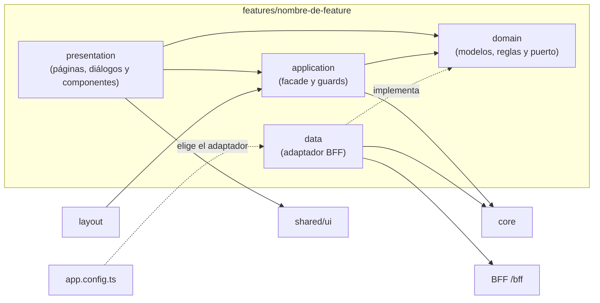

# Arquitectura del frontend

Cómo se organiza el código del workspace Angular: dos aplicaciones (Storefront y Admin, que el producto llama storefront y backoffice: [glosario](../docs/architecture/glosario.md#aplicaciones)), reglas de dependencia, convenciones, integración con el BFF y pruebas. Sigue el mismo esquema que el frontend de IdShield.

No incluye versiones (están en [`package.json`](package.json)) ni comandos (están en el [README](../README.md) y en el [`AGENTS.md` raíz](../AGENTS.md)). La vista de sistema está en [`docs/architecture/README.md`](../docs/architecture/README.md).

## 1. Alcance y stack

| Pieza                            | Uso                                                                                                                                                                                                                                                                                                                 |
| -------------------------------- | ------------------------------------------------------------------------------------------------------------------------------------------------------------------------------------------------------------------------------------------------------------------------------------------------------------------- |
| Angular                          | Componentes standalone, signals, `inject()`, `OnPush`, formularios reactivos tipados y rutas con carga diferida                                                                                                                                                                                                     |
| Angular Material y CDK           | Diálogos, menús, selects, foco y overlays                                                                                                                                                                                                                                                                           |
| Tailwind CSS (vía PostCSS)       | Layout y utilidades; solo analiza el código de cada aplicación (`source(none)` + `@source '.'` en `styles.css`)                                                                                                                                                                                                     |
| Tokens CSS                       | Paleta B (azul cobalto, el tema por defecto y el respaldo), tipografía y espaciado en [`src/styles/tokens.css`](src/styles/tokens.css). El tema activo llega del BFF (`/bff/appearance/theme.css`) y redefine los tokens del tema; ver [§5](#5-integración-con-el-bff) y el [sistema visual](docs/VISUAL-SYSTEM.md) |
| ESLint, angular-eslint y Sheriff | Calidad y límites entre capas y features ([`eslint.config.mjs`](eslint.config.mjs), [`sheriff.config.ts`](sheriff.config.ts))                                                                                                                                                                                       |

## 2. Estilo arquitectónico

Cada aplicación se organiza **por features con capas internas** ([ADR-0006](../docs/adrs/0006-organizar-el-frontend-por-features-y-capas.md)). Dentro de cada feature se aplican puertos y adaptadores: `domain/` define el puerto `<Concepto>Gateway` (clase abstracta, sin Angular) y `data/` lo implementa con `Bff<Concepto>Gateway`. `app.config.ts` es la raíz de composición: asocia cada puerto con su adaptador.



### 2.1. Reglas obligatorias

| Desde                                                  | Puede depender de                                                     | No puede depender de                             |
| ------------------------------------------------------ | --------------------------------------------------------------------- | ------------------------------------------------ |
| `domain/`                                              | `domain/` de su feature o de otra feature permitida                   | Angular, RxJS ni ninguna otra capa               |
| `application/`                                         | `application/` y `domain/` de su feature o de otra permitida, `core/` | `data/`, `presentation/`, `@angular/common/http` |
| `data/`                                                | `domain/`, `core/`, `HttpClient`                                      | `application/`, `presentation/`                  |
| `presentation/`                                        | `application/`, `domain/`, `core/`, `shared/ui/`                      | `data/`, `@angular/common/http`                  |
| `<feature>.routes.ts`                                  | `presentation/` y `application/` de su feature                        | `data/`                                          |
| `layout/`                                              | `application/` y `domain/` de las features, `core/`, `shared/ui/`     | `data/`                                          |
| `shared/ui/`                                           | `core/`                                                               | `features/`, `layout/`                           |
| `core/`                                                | Solo Angular y librerías técnicas                                     | `features/`, `layout/`, `shared/`                |
| Raíz de composición (`app.config.ts`, `app.routes.ts`) | Todo                                                                  | —                                                |

1. Una feature solo usa `domain/` y `application/` de otra, en la dirección declarada en `sheriff.config.ts` y sin ciclos. Storefront y Admin no se importan entre sí.
2. Solo `data/` y `core/` usan `HttpClient`. La aplicación recibe los errores del BFF como `BffRequestError` ([`core/bff-request.error.ts`](src/app/core/bff-request.error.ts)).
3. Cada feature tiene una sola facade, que expone el estado con signals y coordina las operaciones. Las páginas no llaman al BFF.
4. No se crean capas vacías, abstracciones que solo deleguen ni barrels (`index.ts`).

Sheriff impone la regla 1; `no-restricted-imports` impone la parte de las reglas 1 y 2 que afecta a librerías externas. Las dos corren con `npm run lint` y la prueba [`tests/architecture/boundaries.test.mjs`](tests/architecture/boundaries.test.mjs) comprueba que siguen rechazando lo prohibido. Si una regla bloquea un cambio, se corrige el diseño, no la regla.

**Diferencia con IdShield.** En IdShield una facade no usa la de otra feature. En WebStore sí, en la dirección declarada, porque el negocio lo pide: el checkout coordina carrito, cuenta y pedidos, y el carrito concilia precios con el catálogo. El grafo sigue siendo acíclico.

### 2.2. Dependencias entre features

```text
Storefront                                   Admin
vitrina  → catalogo, carrito, comparador,    tienda         → sesion
           contenido
carrito  → catalogo                          temas          → sesion
                                             notificaciones → sesion
checkout → carrito, catalogo, contenido, cuenta, envios, pedidos
pedidos  → carrito, catalogo, cuenta, envios
envios   → contenido
```

## 3. Organización del código

```text
src/app/                                  projects/admin/src/app/
├── app.config.ts, app.routes.ts, app.ts  ├── app.config.ts, app.routes.ts, app.ts
├── core/        (BFF: URL base, cabeceras ├── core/        (cabecera Bearer)
│                 y errores)               ├── layout/      (AppLayout, MenuUsuarioComponent,
├── layout/      (AppLayout, menú de       │                 CampanaNotificacionesComponent,
│                 categorías, pie, 404)    │                 SelectorTemaComponent,
│                                          │                 RutaNavegacionComponent, menu.ts)
├── shared/ui/   (empty-state, reveal)     ├── shared/ui/   (plegables, íconos, título, ayudas
│                                          │                 y «sin datos»)
│                                          └── features/
└── features/                                  ├── sesion/  (login, perfil, roles y permisos, guards)
    ├── catalogo/  productos y categorías      ├── tienda/  (dashboard, productos, inventario,
    ├── vitrina/   inicio,                     │             categorías, marcas, clientes, usuarios,
    │              listado, ficha y tarjeta    │             pedidos, banners, contenido, entregas
    │                                          │             y feriados, tarifas,
    ├── carrito/   ├── checkout/  ├── pedidos/ │             reclamaciones)
    ├── cuenta/    ├── envios/    ├── contenido/ (CMS y páginas informativas)
    ├── reclamos/  (libro de reclamaciones)    ├── temas/   (apariencia, tema visible y gestión
    ├── temas/     (apariencia y tema visible) │             de los temas del superadmin)
    └── comparador/ (comparar, lote 19)        └── notificaciones/ (campana de pedidos, reclamos
                                                             y errores de compra, lotes 07b y 13)
```

`temas` existe en las dos aplicaciones, sin código compartido: cada una tiene su modelo, su puerto, su regla `temaVisible`, su cookie de la vista previa (`cookie-vista-previa.ts`) y su `TemasFacade`, que carga la apariencia del BFF y aplica los tokens del tema visible a `<html>`. La de la tienda no depende de ninguna feature y solo la usa la raíz (`App`). La del Admin depende de `sesion` para el token y, además, gestiona los temas del `superadmin`: ante `STALE_THEMES` avisa y recarga la lista, sin reintentar.

Lo que se copia entre las dos aplicaciones se vigila con `tests/architecture/paridad-entre-aplicaciones.test.mjs` (lote 03, PBI-0080): `tema-visible.rules.ts` y su prueba, `cookie-vista-previa.ts`, el selector de tema (salvo su etiqueta), las declaraciones compartidas de `tema.model.ts`, la zona horaria de Lima y la relación de contraste de las e2e frente a `casos-tema.json`. Los roles del Admin se comparan con los del BFF (id, nombre y descripción) en `tools/validate-structure.mjs`. Las reglas de las listas de Contenido del Admin (`tienda/domain/contenido.rules.ts`, lote 15) repiten las del BFF (`backend/src/domain/admin/contenido.rules.mjs`), que es quien decide; la deducción del destino de la «Navegación superior» (PBI-0153) se quitó en el lote 15. Dentro de cada aplicación, lo repetido va en un solo sitio: en el Admin, `shared/ui/plegable.directive.ts` (la flecha `svg[wsAdminFlecha]` y `alternarPlegable`), `tienda/presentation/estado-pedido.ts` y `tienda/domain/correo.rules.ts`; en la tienda, `abrirAgregarAlCarrito` del diálogo «Producto agregado». Las pruebas de `domain/` que transpilan un archivo sin sus `import` anteponen la regla que importa (`correo.rules.ts`).

`vitrina` agrupa la presentación que combina catálogo, carrito y contenido (inicio, listado, ficha de producto, tarjeta y diálogo de agregar al carrito). Así `catalogo` no depende de `carrito`, que sí depende de `catalogo`.

Cada feature tiene hasta cuatro capas, cada una en una carpeta plana. Las rutas de la feature van en `<feature>.routes.ts`, en su raíz (`cuenta`, `vitrina`). `app.routes.ts` conserva las URL públicas: `/`, `/catalogo`, `/comparar` (lote 19), `/carrito`, `/checkout`, `/pedido/:id`, `/pedidos`, `/cuenta/*`, `/info/*`, `/libro-reclamaciones` y la página 404.

## 4. Componentes y convenciones

- Componentes standalone con `inject()`, signals, `input`/`output`, control de flujo integrado y `OnPush`.
- Selectores con prefijo `ws-` (los estilos dependen de ellos) y directivas `ws…`.
- Colores y estados como tokens en `src/styles/tokens.css`. El Admin reutiliza esos tokens.
- Formato: Prettier ([`.prettierrc.json`](../.prettierrc.json) en la raíz del repositorio).

El nombre del archivo indica su rol con un sufijo. La parte de negocio va en español y el término técnico en inglés:

| Rol               | Capa                                     | Archivo                                           | Identificador                              |
| ----------------- | ---------------------------------------- | ------------------------------------------------- | ------------------------------------------ |
| Modelo            | `domain/`                                | `producto.model.ts`                               | `Producto`, `Categoria`                    |
| Reglas            | `domain/`                                | `categoria.rules.ts`, `rol.rules.ts`              | `descendientesDeCategoria()`, `rolPuede()` |
| Puerto            | `domain/`                                | `catalogo.gateway.ts`                             | `CatalogoGateway`, clase abstracta         |
| Facade            | `application/`                           | `carrito.facade.ts`                               | `CarritoFacade`                            |
| Guard             | `application/`                           | `pagina-informativa.guard.ts`, `permiso.guard.ts` | `contactoHabilitadoGuard`, `permisoGuard`  |
| Adaptador del BFF | `data/`                                  | `bff-catalogo.gateway.ts`                         | `BffCatalogoGateway`                       |
| Página            | `presentation/`                          | `detalle-producto.page.ts`                        | `DetalleProductoPage`                      |
| Diálogo           | `presentation/`                          | `agregar-al-carrito.dialog.ts`                    | `AgregarAlCarritoDialog`                   |
| Componente        | `presentation/`, `layout/`, `shared/ui/` | `tarjeta-producto.component.ts`                   | `TarjetaProductoComponent`                 |
| Layout            | `layout/`                                | `app.layout.ts`                                   | `AppLayout`                                |
| Rutas             | raíz de la feature                       | `cuenta.routes.ts`                                | `cuentaRoutes`                             |
| Prueba unitaria   | junto al código                          | `categoria.rules.spec.mjs`                        | —                                          |

- Las piezas sin vocabulario de negocio van en inglés técnico: `EmptyStateComponent`, `RevealDirective`, `BffRequestError`, `bearer()`.
- **Filtros de un listado del Admin** (feature [008](../docs/specs/features/008-filtros-y-registro-del-catalogo/planning.md), entregada con el [PR #48](https://github.com/sebastianaviladev01-xyz/WebStore/pull/48)): los filtros aplicados y la página viven en los parámetros de la URL, no en una signal de la página ni en el navegador. Productos usa `nombre`, `sku`, `categoria`, `marca`, `estado` y `pagina`; Categorías, `nombre`, `padre` y `pagina`; Marcas, `nombre`, `estado` y `pagina`. La página los lee con `leerFiltros*()` y `leerPagina()` y los escribe con `parametrosDeFiltros*()` (`filtro-catalogo.rules.ts`), sin los valores por defecto; un valor desconocido se lee como el valor por defecto. El panel edita un borrador que se iguala a los parámetros cada vez que cambian (también con atrás y adelante); «Buscar» recarga el snapshot con `TiendaFacade.refresh()` y navega sin `pagina`. Las interfaces de registro son rutas propias (`<listado>/nuevo` antes que `<listado>/:id`, con el `id` como `input`) y conservan los parámetros al ir y al volver (`queryParamsHandling: 'preserve'`). Las piezas compartidas son `PanelFiltrosComponent` (`ws-filter-panel`; desde el lote 11, PBI-0171, con «Agregar» en el panel: `agregarQue` y `rutaAgregar`, o el evento `agregar` en los listados que registran en una ventana emergente, que la abren; desde el lote 21 ya no hay registro junto a la lista), `PaginacionComponent` (`ws-pagination`) y `paginar()` de `listado.rules.ts` (`ELEMENTOS_POR_PAGINA`, 25).
- **Mantenimientos del backoffice** (lote 21, [ADR-0025](../docs/adrs/0025-cerrar-por-lotes-lo-que-salio-de-la-revision-de-la-demo.md), PBI-0211; **regla provisional, por confirmar con Daniel**, que la pidió en la revisión de la demo del 2026-11-17). Un formulario de registro de **más de tres campos** se crea y se edita en su propia interfaz de registro, como «Nuevo producto»: ruta `<listado>/nuevo` antes que `<listado>/:id`, con el `id` como `input`, «Regresar» y «Cancelar», que vuelven al listado con sus filtros (`queryParamsHandling: 'preserve'`); al editar trae los datos actuales con `TiendaFacade.refresh()` y, si el registro ya no existe, lo dice. Uno de **hasta tres campos** se crea y se edita en una ventana emergente (`MatDialog`) con `dialogoDeRegistro()` (`tienda/presentation/dialogo-de-registro.ts`): la ventana muestra un `<ng-template>` de la página, así que el formulario, su borrador al vencer la sesión (`conservarBorrador` con `diferido: true`, que se aplica en `afterNextRender` y vuelve a abrir la ventana) y sus validaciones siguen en la página; el título es `mat-dialog-title` (nombre de la ventana y del formulario), la ventana atrapa el foco, lo lleva al primer campo, cierra con Escape, «Cancelar» o clic fuera (sale de la edición) y devuelve el foco al botón que la abrió, y el motivo de un guardado rechazado se muestra dentro de ella (`tomarError()`). Ningún formulario de registro va al costado de la lista. Páginas propias: Productos, Categorías, Usuarios (`RegistroUsuarioPage`) y Banners (`RegistroBannerPage`); ventana emergente: Marcas, Clientes y Tarifas de envío. Los paneles de detalle de Pedidos y Reclamaciones no registran y siguen junto a la lista. «Contenido y configuración» y «Entregas y feriados» son páginas de configuración, no mantenimientos de un listado.
- **Páginas de registro como los formularios del SGC** (lote 44, [ADR-0033](../docs/adrs/0033-construir-por-lotes-lo-que-salio-de-la-reunion-del-2026-11-24.md), PBI-0268; decidido por Sebastián Avila el 2026-11-26, sin esperar a Daniel). Las cuatro páginas propias de registro (producto, categoría, usuario y banner) se arman con cuatro componentes de `tienda/presentation`, porque los usa solo `tienda` y la fila de cabecera lee la sesión (`shared/ui` no puede depender de una feature): `EncabezadoRegistroComponent` (`ws-admin-encabezado-registro`: el `h1` con `wsAdminTitulo`, su descripción y «Regresar»; va fuera del `<form>`, que lo nombra con `aria-labelledby`), `DatosRegistroComponent` (`ws-admin-datos-registro`: «Estado», un `<select>` nativo con su `<label>` que cambia el control `active` del formulario y escucha su `valueChanges`, porque la página lo rellena sin cambiar el input; «Usuario», de `SesionFacade`; y «Fecha», con `fechaDeCabecera` al abrir la página), `SeccionRegistroComponent` (`ws-admin-seccion-registro`) y `PieRegistroComponent` (`ws-admin-pie-registro`: «Cancelar», «Guardar y continuar» solo al crear, que emite `continuar`, y «Guardar», el `submit`; proyecta el motivo de un guardado rechazado). «Guardar y continuar» guarda con el mismo `save()` de la página (`save(true)`) y, si se guardó, navega a `<listado>/<id>` con los filtros (`queryParamsHandling: 'preserve'`); como `<listado>/nuevo` y `<listado>/:id` son rutas distintas, la página de edición se crea de nuevo y trae los datos con `refresh()`. Tras crear con «Guardar», vuelve al listado con sus filtros y, además, `nuevo=<id>` (`parametrosAlVolverDelRegistro`, con `queryParamsHandling: 'merge'`), para que el listado salte a la página del registro creado (PBI-0265); al editar no se añade nada. Las reglas sin DOM están en `tienda/domain/registro.rules.ts`: `fechaDeCabecera` (`dd/mm/aaaa hh:mm` en hora de Lima, con `fechaYHoraVisible` de `banner.rules.ts`), `contadorDeCaracteres` y, para la tabla de características del producto (un `FormArray` de una fila por característica, con al menos una escrita), `filasDeCaracteristicas` y `caracteristicasDeLasFilas`: el contrato con el BFF no cambia (`highlights` sigue siendo la lista de textos sin vacíos). Las ayudas llevan el ícono «info» con `TextoAyudaComponent` (`ws-admin-texto-ayuda`, `shared/ui`). Las ventanas emergentes de registro no usan estas piezas.
- **Ruta de navegación** (lote 44, ADR-0033, PBI-0271): el menú lateral se configura en `layout/menu.ts` (`MENU`, sin Angular), que usan `AppLayout` y `RutaNavegacionComponent` (`ws-admin-ruta-navegacion`, `layout/`), en la barra superior. La regla es `rutaDeNavegacion(url, MENU, titulo)` de `layout/ruta-de-navegacion.ts` (sin Angular, con su `ruta-de-navegacion.spec.mjs`): una entrada del menú da su grupo y su etiqueta; una ruta que cuelga de ella (un registro), el grupo, el listado como enlace y el nombre de la página, que sale del título de la ruta activa (`paginaDelTitulo`, sin «WebStore Admin |»); una página fuera del menú (Perfil), solo su nombre; el ícono, de `iconoDelModulo`. El componente la recalcula en cada `NavigationEnd`. Es un `nav` «Ruta de navegación» con una lista ordenada y `aria-current="page"` en la última; el enlace del listado conserva los filtros (`queryParamsHandling: 'preserve'`).
- **Estilo de los botones del banner** (lote 46, [ADR-0033](../docs/adrs/0033-construir-por-lotes-lo-que-salio-de-la-reunion-del-2026-11-24.md), PBI-0266; decidido por Sebastián Avila el 2026-11-26, sin esperar a Daniel). El contrato trae `ctaStyle` y `secondaryCtaStyle` (`primary`, `accent`, `contrast` u `outline`). En la tienda, `botonesDelBanner()` de `contenido/domain/banner.rules.ts` devuelve cada botón con su `posicion` (`primero` o `segundo`, que lo identifica aunque los dos tengan el mismo estilo) y su `estilo`, con `primary` y `accent` por omisión o ante un valor desconocido; `BotonesBannerComponent` lo pasa a la clase (`ws-btn-primary`, `ws-btn-accent`, `ws-btn-contrast` u `ws-btn-outline`). En el Admin, `ESTILOS_DE_BOTON`, `ESTILO_POR_OMISION` y `estiloDeBoton()` de `tienda/domain/banner.rules.ts` dan la lista «Estilo» del registro del banner y el valor al abrirlo; el tipo `EstiloDeBoton` vive en `tienda.model.ts`. Los colores de cada estilo, en [VISUAL-SYSTEM.md](docs/VISUAL-SYSTEM.md).
- **Selección de categoría con búsqueda** (lote 29, [ADR-0027](../docs/adrs/0027-cerrar-por-lotes-lo-que-salio-de-la-reunion-del-2026-11-20.md), PBI-0238; **provisional, por confirmar con Daniel**): el filtro «Categoría» de Productos y el campo «Categoría» del registro del producto usan `SelectorCategoriaComponent` (`ws-admin-selector-categoria`, `tienda/presentation/selector-categoria.component.ts`), en lugar del `mat-select` sangrado. Va en `tienda/presentation` porque sus dos usos son de `tienda` y depende de sus reglas; `shared/ui` no puede depender de una feature. Es un `mat-autocomplete` de Material sobre un `matInput` (`role="combobox"`): recibe el `FormControl<string>` de la página (`id` de la categoría o `''`) y las categorías, y solo cambia el control al elegir o al quitar; lo escrito sin elegir se descarta al salir del campo. Las reglas están en `categoria.rules.ts`: `opcionesDeCategoria()` da cada categoría con su ruta («Electrodomésticos › Refrigeradoras › Side by side») en el orden del árbol, y `buscarCategorias()` no filtra con menos de `MINIMO_PARA_BUSCAR_CATEGORIA` (3) caracteres y, desde ahí, sin mayúsculas ni tildes (`textoBuscable`), devuelve primero las que coinciden por su nombre y después las que están dentro de una que coincide. Enter elige la primera coincidencia; «Quitar la categoría» y «Limpiar filtros» la vacían. El error y el asterisco de obligatorio salen del control de la página, con `mensajeDeError`.
- **Filtros de los demás listados del Admin** (lote 07, [ADR-0017](../docs/adrs/0017-cerrar-el-backlog-por-lotes-como-excepcion-al-flujo.md), PBI-0139): Inventario, Clientes, Usuarios, Banners y Reclamaciones usan el mismo panel y la misma paginación con `filtrosDeListado()` (`tienda/presentation/filtros-de-listado.ts`), que encapsula el borrador, «Buscar», «Limpiar filtros» y la página de la URL; sus reglas y parámetros (`texto`, `estado`, `rol`) están en `filtro-listado.rules.ts`. Productos, Inventario y Clientes son tablas con `role="table"` y sus encabezados (PBI-0132); en el celular, la fila de encabezados de Productos e Inventario se oculta (cada celda dice su columna con un texto `sr-only md:hidden`, lote 07b, PBI-0156) y la de Clientes es solo para lectores de pantalla. El mensaje de cada campo con error sale de `mensajeDeError` (`formulario.rules.ts`).
- **Íconos del backoffice** (lote 31, [ADR-0027](../docs/adrs/0027-cerrar-por-lotes-lo-que-salio-de-la-reunion-del-2026-11-20.md), PBI-0243; **provisional, por confirmar con Daniel**): `shared/ui/iconos.ts` es la única fuente de los íconos del Admin, sin Angular ni dependencias: `ICONOS` (trazos de 24 × 24 de los módulos y de las acciones) e `iconoDelModulo(ruta)`, que da el ícono del módulo por el primer tramo de la ruta (`/productos/p-004?pagina=2` → `productos`; `/perfil` y `/login`, uno propio; otra ruta, `null`); lo prueba `iconos.spec.mjs`. El menú lateral (`AppLayout.trazo()`) y los títulos lo usan, así que el título de una página lleva siempre el ícono de su entrada del menú. En `shared/ui/icono.directive.ts` hay dos directivas, como la flecha de los plegables (el selector de un componente del Admin debe ser un elemento `ws-*`): `IconoDirective` (`svg[wsAdminIcono]="guardar"`) pone en el propio `<svg>` el trazo, `aria-hidden`, `focusable="false"` y 18 px, y va como primer hijo del botón, que lleva `inline-flex items-center gap-2` (en una opción de `mat-menu`, ícono y texto van juntos en un `<span class="inline-flex items-center gap-2">`, porque Material proyecta el contenido en su texto); `TituloPaginaDirective` (`h1[wsAdminTitulo]`) antepone al texto del `h1` el ícono de 28 px del módulo de su ruta (`ActivatedRoute`) y le da `flex items-center gap-3`, sin cambiar su nombre accesible. Lo que a propósito no lleva ícono (un identificador, una fila, un enlace de texto, un aviso, una muestra de tema o la marca) lleva `data-sin-icono` con el motivo; la e2e `admin-iconos` revisa que todo lo demás lo tenga.
- **Se quedan en inglés** ([ADR-0024](../docs/adrs/0024-dejar-en-ingles-el-vocabulario-interno-y-el-contrato.md), que cierra lo que ADR-0003 dejó pendiente de migrar): los métodos, propiedades y signals de las clases (`add()`, `products()`, `isEmpty`), las constantes y funciones auxiliares internas y los campos y rutas del contrato HTTP (`/bff/catalog/products`, `price`, `stock`). No se renombran, y el código nuevo no los toma como ejemplo.

## 5. Integración con el BFF

- Los adaptadores `Bff<Concepto>Gateway` usan `HttpClient` contra `/bff`, que el servidor de desarrollo reenvía al BFF con [`proxy.conf.json`](proxy.conf.json).
- Sesiones: el cliente guarda un token opaco en `sessionStorage` y lo envía como `Bearer`. Los guards son UX; la autorización la repite el BFF.
- El carrito guarda solo id y cantidad en `localStorage`; precio y stock se toman siempre del catálogo vigente. Al leerlo, une las líneas del mismo producto, y cada recarga del catálogo lo concilia con `conciliarCarrito` (`carrito/domain/carrito.rules.ts`), que devuelve lo que cambió para avisarlo (lote 04).
- Checkout (lote 04, [ADR-0017](../docs/adrs/0017-cerrar-el-backlog-por-lotes-como-excepcion-al-flujo.md)): `CheckoutFacade.iniciar()` recarga el catálogo, borra el error anterior y abre un intento de compra con una clave aleatoria que `BffCheckoutGateway` envía en `Idempotency-Key`; un segundo envío en curso se ignora. El comando lleva `termsAccepted` y el `total` que ve el comprador; ante `INSUFFICIENT_STOCK`, `PRODUCT_UNAVAILABLE`, `ORDER_TOTAL_CHANGED` o `SHIPPING_UNAVAILABLE` la facade recarga el catálogo y la página vuelve a cotizar el envío y avisa lo que cambió. `CatalogoFacade.load()` comparte la carga en curso.
- Pedidos: `PedidosFacade` guarda en `localStorage` solo el token de los pedidos de invitado y vacía los pedidos en memoria cuando cambia la sesión de cliente; la regla de si un pedido se puede cambiar es `sePuedeModificar` (`pedidos/domain/pedido.rules.ts`), la misma del BFF (lote 04). La fecha de entrega (`pedidos/domain/fecha-entrega.rules.ts`) la usan el checkout y el detalle del pedido; en el detalle también vale la fecha que el pedido ya tiene (`esCambioDeFechaValido`, lote 05). Desde el lote 17 ([ADR-0021](../docs/adrs/0021-aplicar-por-lotes-los-cambios-que-pidio-daniel.md), PBI-0178; provisional) la tienda no calcula la primera fecha: `PedidosFacade.cargarPrimeraFechaDeEntrega()` la pide al BFF (`GET /bff/checkout/delivery-dates`, con la configuración de la tienda y sus días no laborables) al entrar al checkout y al detalle, y otra vez si el BFF rechaza una fecha (`INVALID_DELIVERY_DATE`). Es el mínimo del campo y la fecha propuesta (`fechaDeEntregaPropuesta`); mientras no llega, el mínimo es hoy en Lima. Ante `TERMS_VERSION_CHANGED`, `CheckoutFacade` recarga el contenido y `terminosCambiaron` hace que la página quite la marca de la casilla de los términos (PBI-0177): el comando lleva `termsVersion`, la de los ajustes que muestra Términos (por eso `checkout` depende de `contenido`).
- Cuenta del cliente (lote 05, [ADR-0017](../docs/adrs/0017-cerrar-el-backlog-por-lotes-como-excepcion-al-flujo.md)): el código de verificación de demostración (`testCode`) se guarda solo en memoria (`CuentaFacade.codigoDeDemostracion`), nunca en la URL; `/cuenta/verificar` pide uno nuevo con `POST /account-verification-requests`. Un `401 AUTHENTICATION_REQUIRED` con la sesión (perfil, «Mis pedidos») llama a `CuentaFacade.expire()`: el perfil lleva a `/cuenta/login?volver=…`, que muestra el aviso y, tras ingresar, vuelve a esa ruta si es de la tienda (`rutaDeRetorno`, `cuenta/domain/cuenta.rules.ts`). Al recargar, solo un `401` borra el token; un fallo de red lo conserva y el perfil ofrece «Reintentar». La política de contraseñas del formulario es `esContrasenaSegura`, la del BFF.
- Catálogo de la tienda (lote 05): los filtros son los parámetros `buscar`, `categoria`, `precioMin` y `precioMax` de la URL (`catalogo/domain/filtro-catalogo.rules.ts`); el panel navega con ellos, sin valores por defecto, y escribir en la búsqueda reemplaza la entrada del historial. Sin precio no hay límite. La búsqueda no distingue tildes ni mayúsculas. Desde el lote 16 ([ADR-0021](../docs/adrs/0021-aplicar-por-lotes-los-cambios-que-pidio-daniel.md), PBI-0181, provisional) el precio es un rango con mínimo y máximo, los dos opcionales e incluidos, en lugar de los topes fijos: los campos se aplican al confirmarlos (salir o Enter) si `validarRangoDePrecio` los acepta, y si no muestran su motivo; `limitesDePrecio` da el precio más bajo y el más alto de lo que se ve sin el filtro de precio, como ayuda. Un enlace con el tope anterior (`precio`) se lee como `precioMax`; un precio que no vale, o un mínimo mayor que el máximo, no filtra.
- Contenido (lote 05): un fallo al recargarlo conserva el que ya llegó; el respaldo de `ContenidoFacade`, mientras no llega, no trae datos de contacto ni avisos de la demo y deja cerradas las páginas informativas. Si nunca llega, `ContenidoFacade.estado()` queda en `sin-contenido` y `AppLayout` muestra `AvisoMantenimientoComponent` («Estamos haciendo mantenimiento», con «Reintentar») en lugar de la cabecera, la página y el pie (lote 15, PBI-0182). El orden de las categorías y el enlace fijo a Envíos salen de `contenido/domain/navegacion.rules.ts`; los avisos de la barra superior, de `aviso.rules.ts` (`BarraAvisosComponent`, PBI-0175; desde el lote 30, PBI-0244, el BFF solo envía los vigentes y `avisosSinVencer` quita, con el temporizador de la barra, el que pasa su «Hasta» con la página abierta); el contacto y las redes, de `contacto.rules.ts` (PBI-0169); las columnas del pie, de `pie.rules.ts` (PBI-0185); y la vigencia y el máximo de banners, de `banner.rules.ts`. Dónde sale «Producto agregado» con los sugeridos lo dice `lugarDeLosSugeridos` (`sugeridos.rules.ts`, lote 16, PBI-0179, provisional): el diálogo por defecto o, si la configuración trae `addToCartDisplay: 'side-panel'`, un panel lateral; `abrirAgregarAlCarrito` lo abre con el mismo `AgregarAlCarritoDialog`, pegado a la derecha y con el alto de la ventana (`ws-cart-side-panel`, `aria-modal`).
- Comparador (lote 19, [ADR-0021](../docs/adrs/0021-aplicar-por-lotes-los-cambios-que-pidio-daniel.md), PBI-0001; provisional): la feature `comparador` no tiene `data/` ni puerto, porque no llama al BFF. `ComparadorFacade` guarda la lista de ids solo en memoria (STD-08 no permite guardarla en el navegador) y `comparador.rules.ts` la gobierna: hasta `MAXIMO_A_COMPARAR` (4) sin repetidos (`alternarEnComparar`, que devuelve `lleno` para avisar), la lectura tolerante de la URL (`idsDesdeLaUrl`) y los productos que ya no están en el catálogo (`productosAComparar`). `BotonCompararComponent` (`ws-compare-toggle`, de `vitrina`) es el botón de alternar de la tarjeta y la ficha; `AppLayout` muestra el acceso «Comparar» con la cantidad cuando hay alguno; `ComparadorPage` (`/comparar?ids=…`) toma la lista de la URL (un enlace compartido la reemplaza), la escribe en ella al quitar sin sumar entradas al historial y quita con un aviso los productos que ya no están a la venta.
- Dirección por producto (lote 19, PBI-0006; provisional): `pedidos/domain/direccion-por-producto.rules.ts` repite la regla del BFF (`modoDeDireccion`, `mismaDireccion`, `destinosDelPedido`, `envioPorDestinos` y `direccionVisible`; su prueba la compara). Con `deliveryAddressMode: 'per-product'` en los ajustes, `CheckoutPage` tiene un `FormRecord` con la dirección de cada línea del carrito («La dirección de entrega» u «Otra dirección»; los campos de la otra se desactivan mientras no se elige), calcula el envío por dirección distinta con las tarifas cargadas y envía `items[].shipping` en las líneas con otra dirección. Ante `PER_PRODUCT_ADDRESS_DISABLED`, `CheckoutFacade` recarga el contenido y la página vuelve a una sola dirección. El detalle del pedido de la tienda y el del Admin (`direccionVisible` de `tienda/domain/pedido.rules.ts`) muestran la dirección de cada línea que la tiene; «Entregas y feriados» del Admin elige el modo (`MODOS_DE_DIRECCION`, comparados con el BFF).
- Guardado del Admin (lote 06, [ADR-0017](../docs/adrs/0017-cerrar-el-backlog-por-lotes-como-excepcion-al-flujo.md)): `TiendaFacade` envía cada cambio como `{ upsert, remove }` con solo los registros y los campos que tocó la persona (`guardar<Registro>(base, editado)`, `eliminar<Registro>(id)`); `base` es el registro tal como se abrió. `prepararCambio` (`tienda/domain/cambio-registro.rules.ts`) decide sobre los datos vigentes: enviar, no hacer nada, o no guardar y avisar si el registro ya no existe o si otra persona cambió esos mismos campos. Tras `409 STALE_SNAPSHOT` recarga y vuelve a decidir una vez. No hay actualización optimista: el estado solo cambia con la respuesta del BFF. `saving` deja un solo guardado en curso y los formularios muestran «Guardando…». Las fotos y el logo se reducen en el navegador antes de guardarse (`foto.rules.ts`, `presentation/reducir-foto.ts`).
- Datos al entrar (lote 07, PBI-0140): la cabecera ya no tiene «Actualizar». Cada ruta del panel (salvo las interfaces de edición `:id`, que traen sus datos, Temas y Perfil) lleva `resolve: { datos: datosDelPanelResolver }`, que llama sin esperar a `TiendaFacade.entrar()`: la primera vez `load()` (con «Cargando operación…» y el aviso del panel) y después `refresh()`, sin aviso global. Corre al cambiar de página, no con los filtros de la URL. El Resumen tiene su «Actualizar». Una página que muestra el motivo de un guardado fallido junto a su botón lo toma con `TiendaFacade.tomarError()`, para que la cabecera no lo repita (PBI-0150).
- Sesión vencida (lote 06): los adaptadores del Admin traducen un `401` a `SesionVencidaError` (`sesion/domain/sesion.gateway.ts`); las facades llaman a `SesionFacade.expirar()` y `AppLayout` lleva al acceso, que muestra el motivo. El acceso recibe si muestra las credenciales de prueba con el token `CREDENCIALES_DE_PRUEBA` de `core/`, que la raíz de composición toma de `TemasFacade.credencialesDePrueba` (`sesion` no depende de `temas`): en modo demo o con `testCredentials` del BFF (ADR-0020). Lote 07 (PBI-0151): al salir de la página con la sesión vencida, `conservarBorrador()` (`tienda/presentation/borrador.ts`) guarda lo escrito en `SesionFacade`, solo en memoria (`sesion/domain/borrador.rules.ts`); `AppLayout` anota la página y, tras ingresar la misma persona, el acceso vuelve a ella (`tomarRetorno()`) y la página restaura el borrador con un aviso. Otra persona no lo recupera, y al recargar se pierde.
- Restaurar la sesión (lote 40, [ADR-0032](../docs/adrs/0032-cerrar-por-lotes-los-hallazgos-de-los-lotes-37-y-38.md), PBI-0257; provisional, por confirmar con Daniel): al cargar el Admin, `SesionFacade` comprueba el token de `sessionStorage` con `SesionGateway.current()`. `BffSesionGateway` traduce un `401` a `SesionVencidaError` y cualquier otro fallo (sin conexión, `5xx`) a `ServicioNoDisponibleError`. Solo el `401` borra el token; con el otro, el token se conserva y la sesión queda «sin comprobar» (`sesionSinComprobar()`), sin usuario. `sesionGuard` no deja entrar al panel sin usuario: lleva al acceso y anota la página que se quiso abrir (`anotarRutaSinComprobar()`). El acceso avisa de que no pudo comprobar la sesión y ofrece «Reintentar» (`reintentarComprobacion()`): si responde, entra a esa página; si es un `401`, borra el token y dice que la sesión venció. Se eligió el acceso para el aviso porque ya es donde el guard lleva sin usuario y no muestra datos del panel.
- Funciones nuevas del Admin (lote 07b, [ADR-0017](../docs/adrs/0017-cerrar-el-backlog-por-lotes-como-excepcion-al-flujo.md); provisionales):
  - Personas en línea (PBI-0027): se quitó en el lote 13 ([ADR-0021](../docs/adrs/0021-aplicar-por-lotes-los-cambios-que-pidio-daniel.md), PBI-0172), con la feature `visitas` de la tienda (el latido `POST /bff/visits`) y `onlineVisitors` del snapshot.
  - Actividad reciente (PBI-0028): `activity` del snapshot; el Dashboard muestra los 10 últimos (`actividadReciente`, `resumen.rules.ts`), al final y solo con `orders.manage`.
  - Notificaciones (PBI-0033): feature `notificaciones` (depende de `sesion`) con `NotificacionesGateway`, `BffNotificacionesGateway` y `NotificacionesFacade`; la campana es `layout/campana-notificaciones.component.ts` (`MatMenu`, reglas en `notificacion.rules.ts`). `AppLayout` la consulta al entrar y en cada `NavigationEnd`; al abrir el menú marca «visto» hasta el aviso más reciente que muestra. Desde el lote 13 (PBI-0173), los avisos (`Aviso`) son pedidos, reclamos y errores de compra; `presentacionDelAviso` da el título, el detalle y la página de cada uno (el pedido en Pedidos, el reclamo filtrado en Reclamaciones, la falta de stock en Inventario, el producto fuera de venta en Productos, el distrito sin tarifa en Tarifas de envío y el total que cambió en Pedidos), y `puedeVerLaCampana` la muestra a quien tiene `orders.view`, `complaints.manage` u `orders.manage`.
  - Perfil propio (PBI-0034): `SesionGateway.actualizarPerfil()` y `cambiarContrasena()`, que devuelven `PerfilError` con el campo del error; `SesionFacade` actualiza el usuario de la sesión. `PerfilPage` valida la contraseña con `esContrasenaSegura` (`perfil.rules.ts`, comparada con el BFF).
  - Menú lateral (PBI-0044): `AppLayout` usa `BreakpointObserver` (1024 px). En escritorio, `reducido` (signal del layout, no se guarda en el navegador) deja solo los íconos, con el nombre en `title` y en el nombre accesible; por debajo, la hamburguesa abre el menú en un panel con `role="dialog"`, `cdkTrapFocus` y Escape. Los íconos son SVG en línea (`ICONOS`, desde el lote 31 en `shared/ui/iconos.ts`, con el ícono de cada módulo según su ruta en `iconoDelModulo()`, el mismo que lleva el título de sus páginas).
  - Imagen de la categoría (PBI-0052): `Categoria.imageUrl` en las dos aplicaciones; desde el lote 11 (PBI-0176) el registro de la categoría acepta una foto PNG, JPG o WebP de menos de 1 MB (`motivoParaNoUsarFotoDeCategoria`) y genera con `imagenDeCategoria(archivo)` la única versión que se guarda, un cuadrado de 100 × 100 px con la foto entera y centrada (`encajeEnCuadrado`; `LADO_IMAGEN_CATEGORIA` y `MAX_CARACTERES_IMAGEN_CATEGORIA`, comparados con el BFF, que valida formato y medidas pero no reduce). La tienda la muestra en `MenuCategoriasComponent` (`ws-navigation-category-image`) y en el panel del celular y, desde el lote 11 (PBI-0162), en las opciones del filtro «Categoría» de `CatalogoPage` y en las tarjetas de `AccesosRapidosComponent`; el Admin, en la lista de `CategoriasPage`.
  - Entregas y feriados (lote 17, [ADR-0021](../docs/adrs/0021-aplicar-por-lotes-los-cambios-que-pidio-daniel.md), PBI-0178 y PBI-0183; provisional): `EntregasPage` (`/entregas`, `content.manage`) guarda `firstDeliveryDay` y `deliveryCutoffTime` con `guardarConfiguracion` y los días no laborables con `agregarDiaNoLaborable` y `quitarDiaNoLaborable` (colección `nonWorkingDates` del snapshot). Las reglas de `tienda/domain/entrega.rules.ts` (reglas, hora de corte, explicación, años del filtro y motivo para no agregar un día) repiten las del BFF, que decide. Contenido solo carga y envía sus propios campos de la configuración y muestra la versión vigente de los términos (PBI-0177); el detalle de Pedidos, la aceptada (`versionDeTerminos`, `pedido.rules.ts`).
  - Pedidos y Tarifas de envío (PBI-0155) usan `filtrosDeListado()` con `leerFiltrosPedidos` y `leerFiltrosTarifas`; Tarifas pagina con `paginar()` y conserva su borrador (`borradorDeTarifasVigente`, PBI-0157). Desde el lote 21 (ADR-0025, provisional) el distrito de una tarifa se elige de una lista (PBI-0216: `opcionesDeDistrito()` de `tienda/domain/distrito.rules.ts`, los 50 distritos de Lima Metropolitana y el Callao más los que ya tienen tarifa; varios al crear y uno al editar) y ya no hay ajuste porcentual (PBI-0217). Productos e Inventario dicen la columna de cada celda a un lector de pantalla en el celular (PBI-0156). El registro de producto ya no tiene la rama de «solo la ficha» y `productos/:id` pide `products.manage` (PBI-0158).
- Contrato: [`backend/docs/BFF-CONTRACT.md`](../backend/docs/BFF-CONTRACT.md).

Temas (feature [002](../docs/specs/features/002-temas-configurables/planning.md)):

- Tema activo ([ADR-0010](../docs/adrs/0010-aplicar-el-tema-activo-con-una-hoja-de-estilos-del-bff.md)): los dos `index.html` cargan `/bff/appearance/theme.css` con un `<link rel="stylesheet">` que bloquea el primer pintado. La hoja redefine los tokens del tema en un bloque `:root:root`, que gana a `tokens.css`. `tokens.css` es la paleta B y el respaldo, y las plantillas y los estilos solo usan tokens (lo comprueba `tools/validate-structure.mjs`, TEST-18). Durante la sesión, `TemasFacade` aplica los cambios con `style.setProperty` sobre `<html>`.
- Build: el `<link>` lleva `data-beasties-skip`. La optimización de CSS crítico de `@angular/build` (beasties) intenta leer del disco las hojas de `index.html` y avisa «Unable to locate stylesheet /bff/appearance/theme.css». Con el atributo, la deja fuera: el build no avisa y la hoja sigue bloqueando el pintado (sin `media="print"`). Lo comprueba TEST-18 (c).
- **Riesgo aceptado:** si el BFF acepta la conexión y no responde, la página espera la hoja hasta el tiempo límite del navegador. Si la rechaza o responde con error, se ve B (TEST-22).
- Cálculo ([ADR-0011](../docs/adrs/0011-guardar-los-temas-como-recurso-propio-del-bff.md)): el BFF calcula los tokens y el contraste. El dominio de la feature `temas` del Admin los replica solo para la vista previa, y la tienda no calcula nada.
- Lienzo de la tienda ([ADR-0013](../docs/adrs/0013-dar-a-la-tienda-un-token-propio-para-su-lienzo.md)), de la feature [004](../docs/specs/features/004-ajustes-de-la-tienda/planning.md), entregado con el [PR #26](https://github.com/sebastianaviladev01-xyz/WebStore/pull/26): la tienda pinta su lienzo con el token `--ws-store-bg` (en `html`, `body`, el shell y la página 404) y la clase `bg-store-canvas` (`--color-store-canvas` en `tokens.css`), y la vista previa de Temas del Admin también. `bg-canvas` sigue siendo `--ws-bg`: el lienzo del Admin y el relleno de los buscadores. La réplica del Admin incluye el token y los pares nuevos (31 tokens y 20 pares).
- Texto sobre el enlace ([ADR-0014](../docs/adrs/0014-dar-al-tema-un-token-para-el-texto-sobre-el-enlace.md), aceptado), de la feature [005](../docs/specs/features/005-contraste-de-controles-con-los-temas/planning.md), entregado con el [PR #35](https://github.com/sebastianaviladev01-xyz/WebStore/pull/35): `tokens.css` declara `--ws-on-link: #ffffff` (el valor de B) y mapea `--mat-sys-on-primary` a `var(--ws-on-link)`, porque `--mat-sys-primary` ya es el enlace. Con C, la marca de las casillas marcadas del Admin pasa de 1:1 a 15.80:1. El botón relleno conserva sus tokens de la feature 004 (`--ws-primary` y `--ws-on-primary`) y suma `--mat-button-filled-state-layer-color: var(--ws-on-primary)`. La réplica del Admin incluye el token y el par `onLink/link` (32 tokens y 21 pares), y `NombreToken` lo tiene en las dos aplicaciones. Sin clase de Tailwind: ninguna plantilla lo usa.
- Error, alerta y texto sobre el principal ([ADR-0019](../docs/adrs/0019-calcular-con-el-tema-el-error-la-alerta-y-el-texto-sobre-el-principal.md)), lote 03: `--ws-danger*` y `--ws-warning*` pasan de fijos a tokens del tema (37 tokens y 27 pares en la réplica del Admin; `NombreToken` en las dos aplicaciones), con los mismos valores en `tokens.css` y las mismas clases de Tailwind. `tokens.css` también da a Material el relleno de los campos (`--ws-border`), el panel de las listas (`--ws-bg`), la opción seleccionada (`--ws-primary-soft` y `--ws-on-primary-soft`) y el error de un campo relleno con el puntero encima (`--ws-danger`), que antes salían fijos de `azure-blue.css`.
- Borde del acento ([ADR-0023](../docs/adrs/0023-dar-al-tema-un-borde-del-acento-y-un-acento-fuerte-legible.md)), lote 14 (PBI-0189): `--ws-accent-line` (38 tokens en la réplica del Admin y en `NombreToken` de las dos aplicaciones; clase de Tailwind `accent-line`) contornea lo que se rellena con el acento: la insignia «Oferta» (que además usa `--ws-on-accent`), el contador del carrito, `ws-btn-accent`, la vista previa de Temas y las barras de «Clientes nuevos».
- Secundario visible ([ADR-0028](../docs/adrs/0028-hacer-visible-el-secundario-en-la-tienda-e-invertir-el-tema-c.md)), lote 28 (PBI-0240): en la tienda, `ws-btn-secondary` se rellena con el acento (`--ws-accent`, texto `--ws-on-accent`, borde `--ws-accent-line`), y lo que hoy tenía un fondo neutro con el puntero encima o con el foco (acciones de la cabecera, botones de íconos, controles del carrusel, menús y opciones) pasa a `--ws-accent-soft` con el texto en `--ws-ink`. La insignia «Oferta» de la ficha (`ws-pdp-badge is-offer`) lleva el acento, como la de la tarjeta. La réplica del Admin mide 29 pares (`contrast/accentSoft` y `muted/accentSoft`), y la vista previa de Temas muestra ese fondo.
- Principal fuerte que no se distingue ([ADR-0030](../docs/adrs/0030-alejar-el-principal-fuerte-que-no-se-distingue-del-principal.md)), lote 34 (PBI-0247): la réplica del Admin (`tema.rules.ts`) repite la regla del BFF para la vista previa de Temas; `casos-tema.json` compara las dos (TEST-14). La tienda no cambia: aplica el mapa que sirve el BFF.
- Enlaces de la tienda (feature [005](../docs/specs/features/005-contraste-de-controles-con-los-temas/planning.md), D1), entregado con el [PR #35](https://github.com/sebastianaviladev01-xyz/WebStore/pull/35): la regla `a { color: inherit; text-decoration: none; }` de `src/styles.css` está dentro de `@layer base`, junto a la de márgenes. Fuera de capa anulaba las utilidades de color y de subrayado de los enlaces, que ahora se aplican. Las clases `ws-*` y `a:focus-visible` siguen fuera de capa y no cambian.
- Vista previa en modo demo ([ADR-0012](../docs/adrs/0012-activar-el-modo-demo-y-recordar-la-vista-previa-en-una-cookie.md) y [ADR-0022](../docs/adrs/0022-quitar-la-tuerca-de-la-tienda-y-limitar-la-demo-a-los-temas-predefinidos.md)): `TemasFacade.verTema` del Admin guarda el id de un tema predefinido en la cookie `ws_tema_vista_previa` (`Path=/`, `SameSite=Lax`, 30 días, `Secure` con `https`), que comparten la tienda y el Admin solo en el mismo host (sin `Domain`; en subdominios distintos, no: PBI-0072) y que el BFF lee solo en modo demo para servir `theme.css`. La tuerca «Cambiar tema» (`SelectorTemaComponent`, solo en el Admin desde el lote 14, PBI-0188) solo existe en modo demo. Desde el lote 35 (PBI-0249, provisional) vive en `layout/`: en el panel es un botón de ícono de la barra superior de `AppLayout`, a la izquierda de la campana, y solo en el acceso, que no tiene barra, sigue flotando abajo a la derecha (`App`). Ofrece A, B y C (`TemasFacade.temasDeLaTuerca`) y es la que escribe la cookie. La tienda no tiene tuerca: su `TemasFacade` lee la cookie y pinta esa vista previa, y la regla `temaVisible` de las dos aplicaciones solo la acepta si es un predefinido.

## 6. Pruebas

| Nivel                   | Herramienta                                                                                                                                                                                                                                                                                                                 | Qué se prueba                                                                                                                                                                                                                                                                                                                                                                                                                                                                                                                                                                                                                                                                                                                                                                                                                                                                                                                                                                                                                                                                                                                                                                                                                                                                                                                                                                                                                                                                                                                                                                                                                                                                                                                                                                                                                                                                                                                                                                                                                                                                                                                                                                                                                                                                                                                                                                                                                                                                                                                                                                                                                                                                                                                                                                                                                                                                                                                                                                                                                                                                                                                                                                                                                                                                                                                                                                                                                                                                                                                                                                                                                                                                                                                                                                                                                                                                                                                                                                                                                                                                                                                                                                                                                                                                                                                                                                                                                                                                                                                                                                                                                                                                                                                                                                                                                                                                                                                                                                                                                                                                                                                                                                                                                                                                                                                                                                                                                                                                                                                                                                                                                                                                                                                                                                                                                                                                                                                                                                                                                                                                                                                                                                                                                                                                                                                                                                                                                                                                                                                                                                                                                                                                                                                                                    |
| ----------------------- | --------------------------------------------------------------------------------------------------------------------------------------------------------------------------------------------------------------------------------------------------------------------------------------------------------------------------- | ---------------------------------------------------------------------------------------------------------------------------------------------------------------------------------------------------------------------------------------------------------------------------------------------------------------------------------------------------------------------------------------------------------------------------------------------------------------------------------------------------------------------------------------------------------------------------------------------------------------------------------------------------------------------------------------------------------------------------------------------------------------------------------------------------------------------------------------------------------------------------------------------------------------------------------------------------------------------------------------------------------------------------------------------------------------------------------------------------------------------------------------------------------------------------------------------------------------------------------------------------------------------------------------------------------------------------------------------------------------------------------------------------------------------------------------------------------------------------------------------------------------------------------------------------------------------------------------------------------------------------------------------------------------------------------------------------------------------------------------------------------------------------------------------------------------------------------------------------------------------------------------------------------------------------------------------------------------------------------------------------------------------------------------------------------------------------------------------------------------------------------------------------------------------------------------------------------------------------------------------------------------------------------------------------------------------------------------------------------------------------------------------------------------------------------------------------------------------------------------------------------------------------------------------------------------------------------------------------------------------------------------------------------------------------------------------------------------------------------------------------------------------------------------------------------------------------------------------------------------------------------------------------------------------------------------------------------------------------------------------------------------------------------------------------------------------------------------------------------------------------------------------------------------------------------------------------------------------------------------------------------------------------------------------------------------------------------------------------------------------------------------------------------------------------------------------------------------------------------------------------------------------------------------------------------------------------------------------------------------------------------------------------------------------------------------------------------------------------------------------------------------------------------------------------------------------------------------------------------------------------------------------------------------------------------------------------------------------------------------------------------------------------------------------------------------------------------------------------------------------------------------------------------------------------------------------------------------------------------------------------------------------------------------------------------------------------------------------------------------------------------------------------------------------------------------------------------------------------------------------------------------------------------------------------------------------------------------------------------------------------------------------------------------------------------------------------------------------------------------------------------------------------------------------------------------------------------------------------------------------------------------------------------------------------------------------------------------------------------------------------------------------------------------------------------------------------------------------------------------------------------------------------------------------------------------------------------------------------------------------------------------------------------------------------------------------------------------------------------------------------------------------------------------------------------------------------------------------------------------------------------------------------------------------------------------------------------------------------------------------------------------------------------------------------------------------------------------------------------------------------------------------------------------------------------------------------------------------------------------------------------------------------------------------------------------------------------------------------------------------------------------------------------------------------------------------------------------------------------------------------------------------------------------------------------------------------------------------------------------------------------------------------------------------------------------------------------------------------------------------------------------------------------------------------------------------------------------------------------------------------------------------------------------------------------------------------------------------------------------------------------------------------------------------------------------------------------------------------------------------------------------- |
| Unitarias de `domain/`  | `node:test`, archivos `*.spec.mjs` junto al código (`npm test`)                                                                                                                                                                                                                                                             | Árbol de categorías del storefront, tarifas de envío del Admin e indicadores del Resumen del Admin (`resumen.rules.spec.mjs`: variación, clientes nuevos, serie del mes, últimos pedidos y estados; los distritos se quitaron en el lote 23), roles y permisos del Admin (`rol.rules.spec.mjs`), las iniciales del usuario del Admin (`usuario-admin.rules.spec.mjs`: `inicialesDeUsuario`) y, de la feature `temas`, el tema visible de la tienda y del Admin (`tema-visible.rules.spec.mjs`) y la réplica de las reglas de temas del Admin (`tema.rules.spec.mjs`, que lee los mismos casos que el BFF). La facade de `temas` del Admin también tiene prueba unitaria (`temas.facade.spec.mjs`: sin reintento tras `STALE_THEMES`). De la feature de filtros y registro del catálogo (008), en `tienda` del Admin: la caracterización del árbol de categorías (`categoria.rules.spec.mjs`), las reglas genéricas de listado (`listado.rules.spec.mjs`: texto sin mayúsculas ni tildes y páginas de 25) y los filtros y sus parámetros de la URL (`filtro-catalogo.rules.spec.mjs`), con la facade (`tienda.facade.spec.mjs`: `load()` y `refresh()`). Del lote 04, en la tienda: el carrito (`carrito.rules.spec.mjs`: líneas guardadas, unidades agregadas y conciliación), la fecha de entrega con la fecha de Lima (`fecha-entrega.rules.spec.mjs`) y si un pedido se puede cambiar (`pedido.rules.spec.mjs`). Del lote 06, en `tienda` del Admin: el cambio de un registro (`cambio-registro.rules.spec.mjs`), los datos únicos (`registro-unico.rules.spec.mjs`), el stock (`inventario.rules.spec.mjs`), los banners (`banner.rules.spec.mjs`), lo que impide eliminar (`eliminacion.rules.spec.mjs`), las fotos (`foto.rules.spec.mjs`) y las fechas de los pedidos (`pedido.rules.spec.mjs`), con el guardado de la facade en `tienda.facade.spec.mjs`; en la tienda, los enlaces de los banners (`enlace.rules.spec.mjs`). Del lote 05, en la tienda: los filtros del catálogo (`filtro-catalogo.rules.spec.mjs`), los productos sugeridos (`sugerencia.rules.spec.mjs`), la contraseña y la ruta de retorno (`cuenta.rules.spec.mjs`, que compara con `requirePassword` del BFF), los banners (`banner.rules.spec.mjs`), la navegación (`navegacion.rules.spec.mjs`), el IGV (`carrito.rules.spec.mjs`, con la fórmula del BFF) y la fecha del detalle del pedido (`fecha-entrega.rules.spec.mjs`). Del lote 07, en el Admin: los roles y los usuarios que gestiona cada uno (`rol.rules.spec.mjs`), los filtros de los demás listados y el estado del stock (`filtro-listado.rules.spec.mjs`), los mensajes de error (`formulario.rules.spec.mjs`), la dirección única de las categorías (`registro-unico.rules.spec.mjs`), los borradores al vencer la sesión (`borrador.rules.spec.mjs`) y `entrar()` y `tomarError()` de la facade (`tienda.facade.spec.mjs`). Del lote 07b: la actividad reciente (`resumen.rules.spec.mjs`), la campana (`notificacion.rules.spec.mjs`), la contraseña del perfil (`perfil.rules.spec.mjs`), la imagen de la categoría (`foto.rules.spec.mjs`), los filtros de Pedidos y Tarifas (`filtro-listado.rules.spec.mjs`) y el borrador de Tarifas (`tarifa-envio.rules.spec.mjs`); en la tienda, el latido (`visita.rules.spec.mjs`). Del lote 08: el Resumen del Admin con el mismo mes del año anterior, el texto de la variación y los grupos de estado (`resumen.rules.spec.mjs`), el umbral de stock bajo (`inventario.rules.spec.mjs`), el máximo de la galería (`foto.rules.spec.mjs`), el tema por defecto y el mensaje del tema activo comparados con los del BFF (`tema-visible.rules.spec.mjs`, `tema.rules.spec.mjs`), `eliminarRegistro` (`eliminar-registro.spec.mjs`), las facades de la campana (`notificaciones.facade.spec.mjs`) y de la tienda del Admin con `desactualizado` (`tienda.facade.spec.mjs`) y los adaptadores sin DOM de tienda, temas y notificaciones (`bff-*.gateway.spec.mjs`). Del lote 12: el botón del banner a medias y el largo de su texto, el mismo que valida el BFF (`banner.rules.spec.mjs` del Admin); en la tienda, los botones que muestra cada banner (`botones-banner.rules.spec.mjs`) y los enlaces que se abren en otra pestaña (`enlace.rules.spec.mjs`). Del lote 15: en la tienda, los avisos de la barra superior (`aviso.rules.spec.mjs`), el contacto y las redes (`contacto.rules.spec.mjs`), las columnas del pie (`pie.rules.spec.mjs`), el enlace fijo a Envíos (`navegacion.rules.spec.mjs`) y el aviso de mantenimiento de la facade (`contenido.facade.spec.mjs`); en el Admin, las reglas de las listas de Contenido (`contenido.rules.spec.mjs`) y el motivo de una regla en los mensajes de error (`formulario.rules.spec.mjs`). Del lote 16: en la tienda, el rango de precio del catálogo (`filtro-catalogo.rules.spec.mjs`) y el lugar de los sugeridos (`sugeridos.rules.spec.mjs`); en el Admin, los lugares de los sugeridos comparados con los del BFF (`contenido.rules.spec.mjs`). Del lote 17: en la tienda, la fecha propuesta con la primera fecha del BFF (`fecha-entrega.rules.spec.mjs`); en el Admin, la primera fecha de entrega y los días no laborables comparados con el BFF (`entrega.rules.spec.mjs`) y la versión de los términos aceptada (`pedido.rules.spec.mjs`). Del lote 19: en la tienda, el comparador (`comparador.rules.spec.mjs`) y la dirección por producto comparada con el BFF (`direccion-por-producto.rules.spec.mjs`); en el Admin, los modos de dirección comparados con el BFF (`entrega.rules.spec.mjs`) y la dirección de una línea (`pedido.rules.spec.mjs`). Del lote 31, en `shared/ui` del Admin: el ícono del módulo de cada ruta, el mismo del menú lateral, y los trazos de los íconos (`iconos.spec.mjs`). Del lote 40, en el Admin: qué muestra la edición de un registro según responda o no la consulta (`tienda/domain/edicion.rules.spec.mjs`, PBI-0256), la restauración de la sesión en la facade (`sesion/application/sesion.facade.spec.mjs`: solo un `401` borra el token, PBI-0257) y su adaptador (`sesion/data/bff-sesion.gateway.spec.mjs`). Del lote 44, en el Admin: la ruta de navegación de la barra superior a partir de la URL, el menú y el título de la ruta (`layout/ruta-de-navegacion.spec.mjs`, PBI-0271) y, de las páginas de registro, la fecha de la cabecera en hora de Lima, el contador de caracteres y las filas de las características (`tienda/domain/registro.rules.spec.mjs`, PBI-0268) |
| Límites de arquitectura | `node:test` con la API de ESLint ([`tests/architecture/`](tests/architecture/), `npm run test:architecture`)                                                                                                                                                                                                                | Que Sheriff y `no-restricted-imports` rechazan lo prohibido y aceptan lo permitido, sin escribir en `src/`                                                                                                                                                                                                                                                                                                                                                                                                                                                                                                                                                                                                                                                                                                                                                                                                                                                                                                                                                                                                                                                                                                                                                                                                                                                                                                                                                                                                                                                                                                                                                                                                                                                                                                                                                                                                                                                                                                                                                                                                                                                                                                                                                                                                                                                                                                                                                                                                                                                                                                                                                                                                                                                                                                                                                                                                                                                                                                                                                                                                                                                                                                                                                                                                                                                                                                                                                                                                                                                                                                                                                                                                                                                                                                                                                                                                                                                                                                                                                                                                                                                                                                                                                                                                                                                                                                                                                                                                                                                                                                                                                                                                                                                                                                                                                                                                                                                                                                                                                                                                                                                                                                                                                                                                                                                                                                                                                                                                                                                                                                                                                                                                                                                                                                                                                                                                                                                                                                                                                                                                                                                                                                                                                                                                                                                                                                                                                                                                                                                                                                                                                                                                                                                       |
| Estructura y contrato   | [`tools/validate-structure.mjs`](../tools/validate-structure.mjs) y el smoke test del BFF (`npm run validate:contract` desde la raíz)                                                                                                                                                                                       | Rutas, guards, CMS compartido, roles, el contrato HTTP completo (incluidos los temas), que el tema B del BFF sea igual a `tokens.css`, que no quede ningún color fijo fuera de `tokens.css` y que no falte el `<link>` de `theme.css`                                                                                                                                                                                                                                                                                                                                                                                                                                                                                                                                                                                                                                                                                                                                                                                                                                                                                                                                                                                                                                                                                                                                                                                                                                                                                                                                                                                                                                                                                                                                                                                                                                                                                                                                                                                                                                                                                                                                                                                                                                                                                                                                                                                                                                                                                                                                                                                                                                                                                                                                                                                                                                                                                                                                                                                                                                                                                                                                                                                                                                                                                                                                                                                                                                                                                                                                                                                                                                                                                                                                                                                                                                                                                                                                                                                                                                                                                                                                                                                                                                                                                                                                                                                                                                                                                                                                                                                                                                                                                                                                                                                                                                                                                                                                                                                                                                                                                                                                                                                                                                                                                                                                                                                                                                                                                                                                                                                                                                                                                                                                                                                                                                                                                                                                                                                                                                                                                                                                                                                                                                                                                                                                                                                                                                                                                                                                                                                                                                                                                                                            |
| E2E                     | Playwright ([`tests/e2e/`](tests/e2e/), [`playwright.config.ts`](playwright.config.ts)), `npm run test:e2e`                                                                                                                                                                                                                 | Recorridos derivados de la [matriz de trazabilidad](../docs/planning/TRACEABILITY.md) contra el BFF de prueba real: navegación y 404, catálogo y ficha, carrito con IGV, compra como invitado, cuenta de cliente, libro de reclamaciones, CMS y acceso al Admin por rol. De la feature de temas: `storefront-temas` (con C activo, la tienda no conserva colores de B, y la hoja no parpadea), `storefront-modo-demo` y `admin-modo-demo` (la tuerca «Cambiar tema» y su vista previa) y `admin-temas` (la página de temas del `superadmin`). De la feature de ajustes del Admin: `admin-menu-lateral` (grupos plegables del menú lateral), `admin-resumen` (bloques plegables del Resumen) y `admin-menu-usuario` (menú de usuario de la cabecera y página Perfil). De la feature de ajustes de la tienda: `storefront-checkout-panel` (el panel de los tres pasos del checkout y sus campos con contorno: reposo, foco, error, orden de Tab y movimiento reducido, medidos con `getComputedStyle`). De la feature de contraste de controles: `storefront-enlaces` (el texto de «Ver todos los productos» del cajón móvil con A, B y C, y los diez enlaces de la tienda con su utilidad de color o de subrayado, en reposo y con el puntero), `admin-casillas` (la casilla marcada de `/contenido` con A, B, C y un tema propio de principal claro), y `storefront-material-contraste` y `admin-material-contraste` (cada componente de Material que pinta sobre el principal, con su relación de contraste en las anotaciones). De la feature del desborde de productos del Admin: `admin-productos-movil` (sin desplazamiento horizontal a 360, 375 y 390 px con A, B y C, el formulario y la galería dentro de su tarjeta, la lista legible sin desplazar y el escritorio igual a 768 y 1440 px). De la feature de filtros y registro del catálogo (008): `admin-catalogo-filtros` (filtros, «Buscar» y «Limpiar filtros», paginación e interfaces de registro de Productos, Categorías y Marcas; la disposición de las tres a 1440 px; el vendedor; sin desplazamiento horizontal a 360, 375 y 390 px con A, B y C; y los fallos al buscar y al guardar), que cambia datos como «otra sesión» con la ayuda [`apoyo/catalogo.ts`](tests/e2e/apoyo/catalogo.ts), por la API del Admin, y los restaura en un `finally`. Del lote 04: `storefront-carrito-checkout` (términos, mensajes y fecha del checkout, doble clic, cambios de precio, diálogo al agregar, líneas repetidas, pedidos al cerrar sesión, cotización del envío, estados de carga y error, y cambios de un pedido enviado), que simula los fallos del BFF con `page.route` y cambia el precio como «otra sesión» con `apoyo/catalogo.ts`, restaurándolo en un `finally`. Del lote 06: `admin-guardado-y-datos` (guardado por registro, reintento tras `409`, doble clic, fotos, datos únicos, registros en uso, stock, banners, Pedidos, credenciales, sesión vencida y Contenido) y `storefront-banners` (enlace externo de un banner), con `leerSnapshot` y `enviarCambios` de `apoyo/catalogo.ts`. Del lote 05: `storefront-catalogo-accesibilidad` (404, avisos de `NgOptimizedImage`, sugeridos, favicon de la tienda y del Admin, foco de los filtros, filtros en la URL, «Saltar al contenido», contenido ante un fallo con `page.route`, precio y tildes, Escape en el menú) y `storefront-cuenta-formularios` (verificar y reenviar el código, campos con contorno, mensajes por campo y nombres accesibles, sesión vencida y BFF caído, constancia de reclamaciones y fecha del detalle del pedido). Del lote 07: `admin-permisos` (Usuarios con el administrador y el superadministrador y los `403` del BFF) y `admin-listados` (datos al entrar y «Actualizar» del Resumen, filtros de los demás listados, tablas sin desborde a 375 px, mensajes de error, foco de los archivos, categorías repetidas, fechas de Lima con el navegador en Tokio, borradores al vencer la sesión y aviso de la navegación). Del lote 07b: `admin-funciones-nuevas` (Pedidos y Tarifas con el panel estándar, borrador de Tarifas, actividad y personas en línea, campana, perfil, menú reducido y panel del celular, imagen de la categoría), `storefront-visitas` (latido sin cookie) y `storefront-categoria-imagen`. Comparten la ayuda [`apoyo/contraste.ts`](tests/e2e/apoyo/contraste.ts): `relacionDeContraste`, el fondo efectivo y la activación de temas por la API del Admin. Localizan los controles de Material por su rol y su nombre, sin clases `mdc-*`. El BFF de las e2e arranca en modo demo. Del lote 08: `admin-borrados-y-tarifas` (eliminar un producto, una marca, una categoría y un usuario hasta el BFF y el ciclo de una tarifa), y refuerzos en `storefront-temas` (el lienzo en el contenedor visible y en la 404), `admin-temas` (el Admin conserva su fondo con A y C), `storefront-checkout-panel` (375 px con A, B y C), `admin-menu-lateral` (Tab salta un grupo plegado), `admin-resumen` (moneda, variación y estados vacíos con un snapshot propio), `admin-listados` (aviso de datos desactualizados), `storefront-temas-contraste` (tema propio claro) y `storefront-catalogo-accesibilidad` (fotos prioritarias). Comparten, además, `apoyo/campos.ts` (contorno por píxeles) y `apoyo/fotos.ts`. Del lote 12: `storefront-banners` (los dos botones del banner principal con la paleta primaria y la secundaria, a 4.5:1 o más con A, B y C; el secundario de una promoción; y los enlaces `https://…` en otra pestaña, con `mailto:` y las rutas de la tienda en la misma) y `admin-guardado-y-datos` (un botón del banner a medias no se envía). Del lote 17: `admin-entregas-y-feriados` (la primera fecha de entrega y su hora de corte, los días no laborables con su filtro por año, el administrador sin acceso, y la versión de los términos en Pedidos y en Contenido) y `storefront-carrito-checkout` (el mínimo y la fecha propuesta del BFF y los términos que cambiaron); los pedidos que las e2e crean por la API envían la versión vigente con `terminosAceptados` (`apoyo/entorno.ts`). Del lote 19: `storefront-comparador` (elegir hasta 4 desde el catálogo y la ficha, el aviso del máximo, el acceso de la cabecera, la tabla, «Quitar» y la URL, un enlace compartido con un producto que ya no existe, nada guardado en el navegador y la tabla a 375 px sin desborde), `storefront-direcciones-por-producto` (el checkout igual con una por pedido; con una por producto, otra dirección, el envío desglosado, el comando y el detalle del pedido; y la vuelta a una por pedido durante la compra) y `admin-direcciones-por-producto` (la opción en «Entregas y feriados» y la dirección de la línea en el detalle del pedido). Del lote 31: `admin-iconos` (en el acceso, en cada página del backoffice, en las ventanas de Temas, Marcas, Clientes y Tarifas y en los menús de usuario y «Cambiar tema», cada botón con texto visible lleva un ícono decorativo de 18 px a la izquierda, salvo lo marcado con `data-sin-icono`; el `h1` lleva el ícono de su módulo, con el mismo trazo que su entrada del menú; y a 375 px ningún botón con ícono se parte ni se desborda). Del lote 40: `admin-registro-producto-sin-datos` y `admin-registros-sin-datos` (con la consulta del snapshot fallando en una carga nueva, los registros del producto, la categoría, el usuario y el banner avisan y reintentan sin decir que no existen; con la consulta respondida, «ya no existe», PBI-0256) y `admin-sesion-restaurar` (con un `503` o un fallo de red al comprobar la sesión, el token se conserva y el acceso reintenta; con un `401`, va al acceso como antes, PBI-0257). Del lote 44: `admin-formularios-registro` (la tarjeta con título, descripción y «Regresar», que conserva los filtros; la fila de cabecera con el estado, el usuario de la sesión y la fecha de Lima con el reloj fijo; las secciones; la tabla de características con «Agregar fila» y la papelera; «Guardar y continuar» del producto y de la categoría, que abre «Editar» y guarda en el BFF; el estado del usuario y del banner y el contador de los botones del banner, PBI-0268) y `admin-ruta-navegacion` (el grupo y la página de un listado, el listado como enlace con sus filtros en un registro, Perfil, el cambio al navegar y, a 375 px, solo la página actual sin desbordar, PBI-0271). Del lote 46: `admin-botones-del-banner` (en el registro del banner, «Estilo» de cada botón con los cuatro estilos, sus muestras en los colores del tema, los de por omisión, el guardado en el BFF y la reapertura) y `storefront-botones-del-banner` (con A, B y C, «Contraste» y «Con borde» en el carrusel y en una promoción, con sus tokens, su contraste y las medidas de siempre, PBI-0266) |
| QA visual e interacción | Scripts CDP de [`tools/qa/`](tools/qa/) con Chrome headless y, con Playwright, las capturas por tema y ancho y su comparación píxel a píxel (`capturas.mjs`, `comparar.mjs`, `preparar-datos.mjs` y `escenarios/`, lote 08, PBI-0057; uso en [Comparar capturas](../docs/development/agent-execution.md#comparar-capturas)) | Capturas, consola sin errores, interacciones clave y que un cambio sin efecto visual no cambie ningún píxel (STD-12)                                                                                                                                                                                                                                                                                                                                                                                                                                                                                                                                                                                                                                                                                                                                                                                                                                                                                                                                                                                                                                                                                                                                                                                                                                                                                                                                                                                                                                                                                                                                                                                                                                                                                                                                                                                                                                                                                                                                                                                                                                                                                                                                                                                                                                                                                                                                                                                                                                                                                                                                                                                                                                                                                                                                                                                                                                                                                                                                                                                                                                                                                                                                                                                                                                                                                                                                                                                                                                                                                                                                                                                                                                                                                                                                                                                                                                                                                                                                                                                                                                                                                                                                                                                                                                                                                                                                                                                                                                                                                                                                                                                                                                                                                                                                                                                                                                                                                                                                                                                                                                                                                                                                                                                                                                                                                                                                                                                                                                                                                                                                                                                                                                                                                                                                                                                                                                                                                                                                                                                                                                                                                                                                                                                                                                                                                                                                                                                                                                                                                                                                                                                                                                             |

- Las e2e levantan sus propios servidores en puertos dedicados (BFF 3400, Storefront 4400 y Admin 4500, con [`proxy.e2e.conf.json`](proxy.e2e.conf.json)) y no interfieren con los de desarrollo. El BFF arranca con un archivo de estado temporal que crea desde el seed; nunca usa `backend/data.json`.
- Cada spec se nombra `storefront-*.spec.ts` o `admin-*.spec.ts`: el prefijo, al comienzo del nombre del archivo (no en la ruta, lote 06, PBI-0147), elige el proyecto de Playwright y su `baseURL`. Los recorridos comparten el estado del BFF y se ejecutan en serie.
- Las e2e solo leen la interfaz: no necesitan cambios en `src/` ni en `projects/`.
- **Localizadores de las e2e (lote 08, PBI-0050 y PBI-0078).** Las aserciones de comportamiento usan roles, nombres accesibles y textos visibles (`getByRole`, `getByLabel`, `getByText`), y esperan con las aserciones de Playwright o con una condición (`expect.poll`, `waitForResponse`, `esperarFotos`), nunca con una pausa fija (`waitForTimeout`). Para acotar una zona sin rol propio se admiten la etiqueta de un componente propio (`ws-root`, `ws-admin-menu-usuario`), un `id` o un atributo `data-*` y los elementos HTML sin rol dentro de un localizador por rol (`strong`, `summary`, `img`). Una clase `ws-*` solo se admite para **medir estilos** (`toHaveCSS`, `boundingBox`) de un elemento sin rol (hoy, `.ws-checkout-panel`), nunca para comprobar un comportamiento. Nunca clases internas de Material (`mdc-*`, `mat-mdc-*`, `cdk-*`) ni recorrer su estructura con `nextElementSibling`, `children[n]` o `mat-pseudo-checkbox`: lo que Material pinta se mide por lo que se ve (`apoyo/pintado.ts` captura el control y lee sus píxeles: el contorno de un campo en `apoyo/campos.ts`, y la casilla marcada, el botón de opción, la marca de la opción seleccionada y la capa de estado de un botón en `apoyo/contraste.ts`, lote 10, PBI-0164) y no se comprueba con el truco de `sr-only` (`width: 1px`), sino por la caja del control. Si Material cambia su estructura, esas medidas siguen valiendo mientras el control se vea igual.
- **Fotos y reloj (lote 08).** Los avisos de `NgOptimizedImage` salen al cargar o pintar una foto: se espera con `esperarFotos(page)` (`apoyo/fotos.ts`) y el aviso de `priority` (NG02955) se evita por estructura, no por suerte: toda foto visible al abrir una página es prioritaria (`fotosVisiblesSinPrioridad`). Un plazo de la aplicación o de Material (los 300 ms con que Material activa las transiciones, el minuto de la campana) se adelanta con el reloj de Playwright (`page.clock.install()` y `fastForward`).
- En local usan el Google Chrome instalado (`channel: 'chrome'`) y no descargan navegadores; la CI instala Chromium con `npx playwright install --with-deps chromium` en el job `e2e`.
- **Tipos y lint (lote 08, PBI-0029, PBI-0056 y PBI-0144).** `npm run verify` comprueba, además del build de cada aplicación, los tipos de todos los archivos de `domain/` del Storefront y del Admin (`tsconfig.domain.json`: un error en un archivo que ninguna página importa ya no pasa, porque las pruebas `*.spec.mjs` borran los tipos al transpilar) y los de las e2e y `playwright.config.ts` (`tsconfig.e2e.json`), y el lint cubre `tests/` y `playwright.config.ts`. Las e2e usan unas pocas APIs de Node, que declara `tests/e2e/node.d.ts` en lugar de sumar `@types/node`; si usan otra, se añade ahí. Desde `frontend/`: `npm run typecheck`.
- Herramientas decididas en [ADR-0009](../docs/adrs/0009-usar-node-test-y-playwright-para-las-pruebas.md).

**Facades y adaptadores sin DOM (lote 08, PBI-0025).** No hace falta un entorno DOM: las facades (`application/`) y los adaptadores (`data/`) no tocan elementos, solo señales, el documento y el puerto. Se prueban como las reglas de `domain/`, con `node:test`: el `*.spec.mjs` junto al código transpila la facade con `typescript` sin sus `import` y le antepone dobles de lo que usa (`signal`, `computed`, `inject`, `Injectable`, el puerto, la sesión y, si hace falta, un `document` con `visibilityState`, `addEventListener` y `defaultView.setInterval` simulados). Ejemplos: `temas.facade.spec.mjs` (sin reintento tras `STALE_THEMES`), `tienda.facade.spec.mjs` (`load()`, `refresh()`, guardado y errores) y `notificaciones.facade.spec.mjs` (actualización de la campana con la pestaña visible u oculta, sin reloj real). Un adaptador se prueba igual, con un `HttpClient` doble que devuelve la respuesta del BFF. Lo que sí necesita navegador (plantillas, foco, estilos) lo cubren las e2e. Una prueba de componentes con DOM (por ejemplo, con `jsdom` o con las pruebas de componentes de Playwright) solo se justifica si aparece una regla de presentación que ni las reglas de `domain/` ni las e2e alcancen; añadiría una dependencia y exige su ADR.
